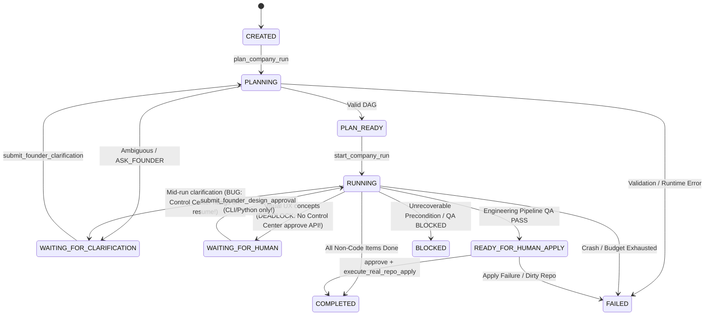

# ორკესტრაციის, მდგომარეობის მანქანის, უსაფრთხოებისა და Control Center-ის აუდიტი (ORCHESTRATION & STATE AUDIT)

**აუდიტის ფაზები:** Phase D (კომუნიკაცია და კონტექსტი), Phase E (მდგომარეობის მანქანა), Phase F (უსაფრთხოება და მმართველობა), Phase G (Control Center და API), Phase J (წარმადობა, ხარჯი და საიმედოობა)

---

## 1. Phase D — აგენტებს შორის კომუნიკაცია და კონტექსტის გადაცემა

### 1.1 რა მუშაობს კარგად
- **კრიპტოგრაფიული არტეფაქტის ხელგამოწოდება (Handoff):** `load_and_verify_input_artifact` ამოწმებს `ArtifactInputRef`-ის SHA-256 ჰეშს დისკზე არსებული ფაილის წინააღმდეგ. ჩვენს ტესტში (`AUDIT-BUG-06`), როცა Research-ის არტეფაქტი შევცვალეთ დისკზე, `assemble_specialist_context`-მა დაუყოვნებლივ დაბლოკა გადაცემა `ContextAssemblyError: SHA-256 integrity mismatch`-ით.
- **Trust Boundary დელიმიტერები:** არასანდო upstream არტეფაქტები ჩასმულია გამყოფ ბლოკებში prompt injection-ის რისკის შესამცირებლად, 100 KB / 150 KB ზომის ლიმიტებით.

### 1.2 დადასტურებული ხარვეზები კონტექსტის გადაცემაში
1. **პრომპტის ჩუმი ჩამოჭრა 28,000 სიმბოლოზე (`runtime.py:167-169`, `AUDIT-BUG-11`):**
   - `cleaned_prompt = cleaned_prompt[:28000]` ჭრის პრომპტის ბოლოს ყოველგვარი გაფრთხილების ან შეცდომის გარეშე.
   - რადგან JSON გამომავალი სქემის ინსტრუქციები ყოველთვის პრომპტის **ბოლოშია**, 28 KB-ზე დიდი კონტექსტისას აგენტი კარგავს გამომავალ სქემას და გარანტირებულად აბრუნებს არავალიდურ პასუხს!
2. **`ContextEnvelope`-ის და `role_knowledge`-ის ჩაგდება 3 როლისთვის (`service.py:5576-5629`):**
   - `execute_next_company_work` ხარჯავს რესურსს `ContextEnvelope`-ის და `role_knowledge`-ის აწყობაზე, მაგრამ **საერთოდ არ გადასცემს მათ `research`, `marketing` და `qa` სპეციალისტებს**.
3. **CEO პრომპტები იგნორირებენ `project_knowledge`-ს (`ceo_contract.py:619, 1130`):**
   - `build_ceo_evaluation_prompt` და `build_ceo_team_selection_prompt` იღებენ `project_knowledge` არგუმენტს ფუნქციის სიგნატურაში, მაგრამ არსად სვამენ პრომპტის ტექსტში.
4. **კვოტის გაუქმება `mandatory_knowledge_sources`-ით (`service.py:5495-5505` + `knowledge.py:632-638`):**
   - ყველა 6 შერჩეული ცოდნის წყარო ემატება `mandatory_knowledge_sources`-ში, რაც ძალას უკარგავს `max_sources=3` შეზღუდვას bounded რეჟიმში და პირდაპირ აჩქარებს 28k ჩამოჭრის დადგომას.
5. **დაკარგული ველები კონტრაქტებს შორის:**
   - `developer_result.py`-ს არ აქვს `verification_actions`, მაგრამ `engineering_pipeline.py:527` კითხულობს `plan_details.get("verification_actions", [])` (ყოველთვის `[]`).
   - `product_result.py`-ის `deliverables` არის თავისუფალი ტექსტი (`content`) და არა სტრუქტურირებული მოთხოვნების ID-ები, რის გამოც QA-ს `requirements_coverage` ხშირად ეფუძნება ინტერპრეტაციას.
6. **კონტექსტის დაბინძურება (Cross-Project Contamination):**
   - `ux_result.py:407-419` (Jester Social Astrology + ქართული ტექსტი + `#FF7A2F`), `prototype_renderer.py:28,183-204`, `service.py:6245-6253` (`/auth/register`), `design_recovery.py:264-475` (`crun_29fcdd4a`), `project.py:412-438` (`prj_jester`), `developer_mutation.py:195` (`"allowed.txt"`).

---

## 2. Phase E — ორკესტრაცია და მდგომარეობის მანქანა (State Machine)

### 2.1 რეალური `CompanyRunState` გრაფი

კოდში (`orchestrator.py:118-136`) განსაზღვრულია 10 სტატუსი (`CANCELLED` არ არსებობს!):

### 2.2 მდგომარეობის მანქანის დადასტურებული დეფექტები

| პრობლემა | ზუსტი ლოკაცია | ეფექტი / მტკიცებულება |
| :--- | :--- | :--- |
| **1. `WAITING_FOR_HUMAN` მუდმივი ჩიხი (Deadlock)** | `service.py:5772-5781` vs `control_center.py` | ვიზუალური კონცეპტების დამტკიცების ენდფოინთი Control Center-ში არ არსებობს; რეალური run `crun_29fcdd4a` გაჭედილია ამ სტატუსში |
| **2. შუა-შესრულების Clarification-ის გაჭედვა** | `control_center.py:1072` vs `service.py:5110-5122` | `control_center.py` მხოლოდ `PLAN_READY`-ზე უშვებს resume worker-ს; თუ `submit_founder_clarification` აბრუნებს `RUNNING`-ს, ნაკადი აღარ ეშვება |
| **3. გაუქმების (`CANCELLED`) სრული არარსებობა** | `orchestrator.py:118-136`, `control_center.py` | დამფუძნებელს არ შეუძლია შეაჩეროს გაშვებული run ან მოკლას 15-წუთიანი `agy` პროცესი (`AUDIT-SCEN-11`) |
| **4. `UnboundLocalError('spec_dur')` მარცხის ბილიკზე** | `service.py:5669, 5684, 5697` vs `5734` | თუ სპეციალისტის შედეგის არტეფაქტი აკლია ან ჰეში არ ემთხვევა, `_handle_work_item_failure` იძახებს ჯერ არგანსაზღვრულ `spec_dur`-ს → დაუმუშავებელი კრაში |
| **5. `Project.add_task` `AttributeError` რესტარტზე** | `service.py:4434` vs `core.py` | სერვისის რესტარტის შემდეგ `execute_real_repo_apply` კრაშავს, რადგან `Project`-ს არ აქვს `add_task` მეთოდი (`AUDIT-BUG-07`) |
| **6. `EXACT_APPROVED_PATCH_PRESENT` დარღვეული იდემპოტენტობა** | `service.py:4469-4477` | თუ პროცესი გაითიშა მას შემდეგ, რაც პატჩი უკვე დაიდო სამიზნე რეპოში, განმეორებითი გაშვება აგდებს `TargetRepositoryDirtyError`-ს იდემპოტენტური აღდგენის ნაცვლად (`AUDIT-BUG-08`) |
| **7. Stale PID Lock მუდმივი ჩიხი** | `real_repo_apply.py:504-530` | კრაშის შემდეგ დარჩენილი `.runs/locks/apply_<hash>.lock` სამუდამოდ ბლოკავს რეპოს; `timeout_seconds` პარამეტრი საერთოდ არ გამოიყენება (`AUDIT-SCEN-09B`) |
| **8. `recovery.py:290` მიუღწევადი retry** | `recovery.py:290` | `attempt_number == 1` პირობა და `max_retries=1` ქმნის ლოგიკურ შეუსაბამობას generic timeout-ის retry-ზე; ხოლო `evaluate_acceptance_criteria` (`recovery.py:604-636`) მხოლოდ ფაილის სახელის substring-ს ამოწმებს |
| **9. არა-იზოლირებული კონკურენტულობა (TOCTOU Race)** | `control_center.py:821-852` | ერთდროულად გაგზავნილი 5 `POST /api/company-runs` მოთხოვნიდან **5-ვემ დააბრუნა HTTP 201** (`AUDIT-SCEN-08`), გვერდი აუარა single-active-run დაცვას და ერთდროულად ცვალა lock-ის გარეშე მყოფი `CompanyService`! |
| **10. ობოლი (Orphaned) გაშვებები `.runs/`-ში** | `.runs/company_runs/*/run_manifest.json` | რეალურ ისტორიაში **25 run გაჭედილია `RUNNING`-ში** და **25 — `CREATED`-ში** (სერვერის რესტარტზე reconciliation არ ხდება) |

---

## 3. Phase F — უსაფრთხოება, უფლებები და მმართველობა (Security & Governance)

### 3.1 კრიტიკული (P0) დადასტურებული მოწყვლადობები

1. **ავთენტიფიკაციის გარეშე დისტანციური კოდის შესრულება (RCE) (`AUDIT-SEC-01`):**
   - **მექანიზმი:** `POST /api/tasks/{id}/execute` (`control_center.py:729-767`) და `/retry` იღებს მომხმარებლის მიერ გამოგზავნილ `verify_cmd` სტრინგს და გადასცემს `execution.py:285`-ს → `subprocess.run(verify_cmd, shell=True, cwd=self.repo_root)`.
   - **გაძლიერებული რისკი:** სერვერი ყველა პასუხზე აბრუნებს `Access-Control-Allow-Origin: *` (`control_center.py:295, 328`) და არ აქვს არანაირი ავთენტიფიკაცია ან CSRF ტოკენი. ეს ნიშნავს, რომ **ნებისმიერ ვებგვერდს, რომელსაც დამფუძნებელი ბრაუზერში გახსნის**, შეუძლია `fetch("http://127.0.0.1:8500/api/tasks/...")`-ით შეასრულოს ნებისმიერი OS ბრძანება დამფუძნებლის კომპიუტერზე!
   - **მტკიცებულება:** იზოლირებულ ტესტში `AUDIT-SEC-01`-მა HTTP POST-ით წარმატებით შექმნა ფაილი `rce_proof_marker.txt` (`CORS: *`).

2. **დისკზე არსებული ფაილების უნებართვო წაკითხვა (Arbitrary File Read / Path Traversal) (`AUDIT-SEC-02`, `AUDIT-SEC-03`):**
   - **ვექტორი A (`/assets/`):** `control_center.py:357-382` (`FRONTEND_DIST_DIR / path.lstrip("/")`) **საერთოდ არ ამოწმებს `is_relative_to`-ს**. `GET /assets/../../package.json`-მა დააბრუნა **HTTP 200** და სრული `frontend/package.json` (`AUDIT-SEC-03`).
   - **ვექტორი B (`/api/artifacts/content`):** `service.py:961-986` ნებას რთავს წაკითხვას მთელ `repo_root`-ში (არა მხოლოდ `.runs/`-ში). `GET /api/artifacts/content?path=../.env`-მა დააბრუნა **HTTP 200** და სიმულირებული საიდუმლო `AUDIT_SECRET=SENTINEL_VALUE_9988` (`AUDIT-SEC-02`).

3. **სინთეზური / გაყალბებული დამფუძნებლის თანხმობები (`AUDIT-SEC-05`):**
   - `engineering_pipeline.py:591`: `founder_approval_id = f"founder_grant_{run.run_id}"`.
   - `engineering_pipeline.py:870-873`: `repair_approvals = {1: f"founder_repair_1_{run.run_id}", 2: f"founder_repair_2_{run.run_id}"}`.
   - `control_center.py:916`: თუ `/approve` ბოდიში `founder_approval_id` არ არის, ავტომატურად აგენერირებს `founder_ui_{run_id}_{uuid}`.
   - ეს პირდაპირ არღვევს არქიტექტურის მთავარ კანონს („Approvals are never fabricated“).

4. **არაიზოლირებული Repair Planning (`service.py:3827-3833`):**
   - Repair Loop-ის დროს `agy --agent developer --dangerously-skip-permissions` ეშვება პირდაპირ `self.repo_root`-ში (`JesterAICompany`), **worktree-ის და `install_planning_policy_hook`-ის გარეშე**.

5. **`--dangerously-skip-permissions` და გაუმართავი `hook_policy.py` (`AUDIT-SEC-06`):**
   - `runtime.py:181` ყველა აგენტს უშვებს `--dangerously-skip-permissions`-ით.
   - `hook_policy.py` არ ამოწმებს `max_bytes_written`-ს და `max_files_changed`-ს, ბლოკავს ახლად შექმნილი ფაილის მეორეჯერ რედაქტირებას, ვერ ნორმალიზებს Windows `\`-ს და არ ცნობს `agy` 1.3.6-ის `read_file`/`write_file`/`edit_file` ინსტრუმენტებს.
   - **მნიშვნელოვანი დაუდასტურებელი ჰიპოთეზა (`HYP-01`):** აუდიტში არ ჩატარებულა ცოცხალი `agy.exe --dangerously-skip-permissions` პრობა იმაზე, იგნორირებს თუ არა `agy` CLI 1.3.6 `.agents/hooks.json`-ს მაშინ, როცა გადაცემულია `--dangerously-skip-permissions`. ეს ცალკე უნდა გადამოწმდეს Stage 0-ში!

---

## 4. Phase G — Control Center UI და Backend/Frontend კონტრაქტები

- **ძლიერი მხარე:** Frontend ტესტ-სუიტი (`vitest`) სუფთად გადის (**13 ფაილი, 74/74 ტესტი PASSED** 4.22 წამში). UI ვიზუალურად კარგად აჩვენებს 7 აგენტს, სტატუსებსა და არტეფაქტებს.
- **კრიტიკული ხარვეზები:**
  1. **`is_production=False` ნაგულისხმევი Control Center-ში (`control_center.py:1149`):** სერვერი ყოველთვის იწყება არა-პროდაქშენ რეჟიმში, რაც თიშავს CEO LLM-ს შეფასებასა და გუნდის შერჩევაზე.
  2. **10-წამიანი HTTP Timeout Frontend-ში (`frontend/src/api/client.ts:32`):** სინქრონული ენდფოინთები (`/api/chat`, `/api/company-runs/{id}/clarify`) ხშირად 10 წამზე მეტხანს მუშაობენ, რის გამოც UI აჩვენებს შეცდომას მაშინ, როცა ბექენდი აგრძელებს მუშაობას.
  3. **Hardcoded `mock=true` რემედიაციაში (`frontend/src/hooks/useCompanyState.ts:274`):** „Remediate Task“ ღილაკი UI-ში ყოველთვის იძახებს `mock=true`-ს!
  4. **ვიზუალური დიზაინის დამტკიცების (Design Approval) არარსებობა:** UI-სა და API-ში არ არის endpoint/კონტროლი `WAITING_FOR_HUMAN` დიზაინის კონცეპტების დასამტკიცებლად ან უარსაყოფად.
  5. **Thread-safety-ს სრული არარსებობა:** `ExclusiveThreadingHTTPServer` + daemon worker ნაკადები მუშაობენ ერთ `CompanyService` ობიექტზე mutex/lock-ის გარეშე.

---

## 5. Phase J — წარმადობა, ხარჯი და რეალური ტელემეტრია

### 5.1 რეალური ისტორიული `.runs/` მონაცემები vs ყალბი ტელემეტრია

`.runs/company_runs/`-ის 349 ჩანაწერის ანალიზმა აჩვენა მკვეთრი განსხვავება რეალურ ოპერაციულ სურათსა და კოდში ჩაწერილ მეტრიკებს შორის:

- **ისტორიული სტატუსების განაწილება (318 მანიფესტი):**
  - `COMPLETED`: **123** (38.7%)
  - `FAILED`: **92** (28.9%) — მთავარი მიზეზები: Unclassified specialist failure (22x), Output validation exhausted (18x), Auth/credential failure (16x), Transient retry exhausted (16x).
  - `RUNNING` (ობოლი/გაჭედილი): **25** (7.9%)
  - `CREATED` (მიტოვებული): **25** (7.9%)
  - `BLOCKED`: **19** (6.0%)
  - `PLAN_READY`: **16** (5.0%)
  - `WAITING_FOR_CLARIFICATION`: **13** (4.1%)
  - `READY_FOR_HUMAN_APPLY`: **4** (1.3%)
  - `WAITING_FOR_HUMAN` (დიზაინის ჩიხი): **1** (`crun_29fcdd4a`)

- **რეალური Wall-Clock ხანგრძლივობები ცოცხალ `agy` გაშვებებზე:**
  - `crun_a406bbf8` (Product + UX + Dev + QA + Repair, `READY_FOR_HUMAN_APPLY`): **1,382.3 წამი (~23 წუთი)**
  - `crun_af72af23` (`BLOCKED`): **1,354.9 წამი (~22.6 წუთი)**
  - `crun_96d9fa15` (`FAILED`): **1,152.2 წამი (~19.2 წუთი)**
  - `crun_f173f987` (`FAILED`): **819.2 წამი (~13.7 წუთი)**
  - `crun_6ca79d6c` (`READY_FOR_HUMAN_APPLY`): **696.1 წამი (~11.6 წუთი)**
  - `crun_0e1e3955` (`READY_FOR_HUMAN_APPLY`): **668.3 წამი (~11.1 წუთი)**
  - `crun_e122312d` (`READY_FOR_HUMAN_APPLY`): **543.7 წამი (~9.1 წუთი)**

- **ტელემეტრიის და ხარჯების კონტროლის ხარვეზები:**
  1. **ყალბი ფიქსირებული ხანგრძლივობები:** კოდში ჩაწერილია ფიქსირებული `0.05s` (CEO), `0.15s` (Developer), `0.1s` (QA) მაშინ, როცა რეალური გაშვებები 9–23 წუთს გრძელდება.
  2. **ჩაყლაპული Developer/QA ტელემეტრია (`AUDIT-BUG-10`):** `engineering_pipeline.py:1024` მიმართავს `qa_exec_art.task_id`-ს (რომელიც `Artifact`-ს არ გააჩნია!), ხოლო `except Exception: pass` (ხაზი 1034) ჩუმად აუქმებს ჩაწერას.
  3. **ნულოვანი ტოკენების/ხარჯის აღრიცხვა და ბიუჯეტის ლიმიტი:** სისტემა არ ითვლის გამოყენებულ ტოკენებს, არ აქვს ხარჯის ზღვარი (budget cap) და არ გააჩნია მოდელის fallback კვოტის ამოწურვისას (HTTP 429).
  4. **უკონტროლო დისკის ზრდა:** `.runs/` უკვე 1,979 ფაილია (10.53 MB), ხოლო `durable_storage.py:506` (`garbage_collect`) ცარიელია.
