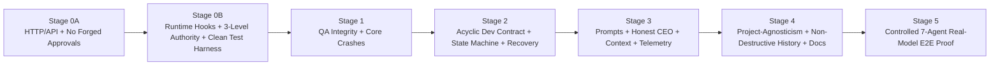

# გადამუშავებული, კრიტიკულად გადახედილი გამოსწორების გეგმა (REMEDIATION PLAN V2)

**დოკუმენტის ტიპი:** პირველი აუდიტის (`DEFECT_REGISTER.md`, `TEST_EXECUTION_REPORT.md`, `REMEDIATION_PLAN.md`) დამოუკიდებელი კრიტიკული გადახედვა და დაზუსტებული, დამოკიდებულებებით გამართული რემედიაციის სტრატეგია  
**თარიღი:** 2026-11-24  
**აუდიტირებული კომიტი:** `b3b31b6` (`main`)  
**სტატუსი:** **გეგმა დამფუძნებლის დასამტკიცებლად — კოდში, პრომპტებში, მონაცემებსა და რეპოზიტორიებში არცერთი ცვლილება არ განხორციელებულა (STOP BOUNDARY)**

---

## 1. წინა აუდიტისა და რემედიაციის გეგმის კრიტიკული თვითშეფასება (Self-Critique)

წინა 7-დოკუმენტიანი აუდიტის დამოუკიდებელმა კრიტიკულმა გადახედვამ გამოავლინა **6 კონკრეტული მეთოდოლოგიური და ლოგიკური ხარვეზი** თავად პირველ `REMEDIATION_PLAN.md`-სა და `DEFECT_REGISTER.md`-ში, რომლებიც ამ დოკუმენტში გასწორებულია:

1. **ლოგიკური წინააღმდეგობა `DEF-004`-თან (P0 გადატანილი იყო Stage 1-ში):**
   - წინა რეესტრში `DEF-004` (სინთეზური/გაყალბებული დამფუძნებლის თანხმობები: `engineering_pipeline.py:591,870-873` და `control_center.py:916`) მართებულად იყო კლასიფიცირებული როგორც **P0**, თუმცა `REMEDIATION_PLAN.md`-ში იგი ამოვარდა Stage 0-დან („უსაფრთხოების გადაუდებელი შეკავება“) და გადატანილ იქნა Stage 1-ში.
   - **მიზეზი, რატომ იყო ეს შეცდომა:** `control_center.py:916` (`founder_approval_id = payload.get("founder_approval_id", f"appr_{uuid.uuid4().hex[:8]}")`) პირდაპირ ექსპონირებულია HTTP API-ზე (როგორც ავტორიტეტის ფაბრიკაცია), ხოლო `engineering_pipeline.py`-ში სინთეზური `founder_grant_*`/`founder_repair_*` ურევს სანდბოქსის ავტომატურ უფლებებს ადამიანის თანხმობასთან. **კორექცია:** ფაბრიკირებული დამფუძნებლის თანხმობების დაუყოვნებელი აკრძალვა გადატანილია **Stage 0A**-ში, ხოლო 3-დონიანი ავტორიტეტის მოდელის სრული გამიჯვნა — **Stage 0B**-ში.
   - **ფაქტობრივი დაზუსტება წინა ტექსტში:** წინა ანგარიშში მითითებული იყო `founder_ui_*`; კოდის ხელახალი წაკითხვით (`control_center.py:916`) ზუსტი ფაბრიკირებული პრეფიქსია `appr_{uuid.uuid4().hex[:8]}`.

2. **წრიული დამოკიდებულება (Circular Dependency) `DEF-007 ↔ DEF-008`:**
   - წინა `DEFECT_REGISTER.md`-ში `DEF-007`-ს ეწერა `Dependencies: DEF-008`, ხოლო `DEF-008`-ს — `Dependencies: DEF-007`. ეს ქმნიდა ციკლურ დაგეგმვას.
   - **კორექცია:** არცერთი არ არის მეორეზე ციკლურად დამოკიდებული — ორივეს აქვს ერთი საერთო ძირეული მიზეზი: Developer-ის შემავალი არტეფაქტების წინაპირობების დუბლირებული და ხისტი კოდირება ორ ადგილას (`service.py:1983` და `engineering_pipeline.py:187-207`). ციკლი იშლება ერთი საერთო აციკლური აბსტრაქციით:
     `DeveloperInputContract` (ერთიანი ვალიდატორი) → `service.py:1983` (`DEF-008` + optional PRD) → `engineering_pipeline.py:187-207` (`DEF-007`).

3. **ტესტ-ინფრასტრუქტურის (`DEF-024`, `DEF-030`) და QA მთლიანობის (`DEF-010`, `DEF-011`) დაგვიანებული დაგეგმვა:**
   - წინა გეგმაში გატეხილი Python baseline ტესტ-სუიტი (`DEF-024` — 16 FAILED, 10 ERRORS, 5 unit ტესტი, რომელიც `subprocess.run` mock-ის გაფუჭების გამო **რეალურ ცოცხალ `agy`-ს იძახებს**!) გადატანილი იყო Stage 4-ში.
   - **რატომ იყო ეს საშიში:** Stage 0–3-ის განმავლობაში დეველოპერი ვერ ენდობოდა `pytest`-ს (10.5-წუთიანი გაშვება, ცრუ წითელი ფონი და ცოცხალი `agy` კვოტის გაჟონვა), ხოლო QA (`DEF-010`, `DEF-011`) შეძლებდა გაეცა `PASS` 0 გაშვებული ტესტით!
   - **კორექცია:** ტესტ-ჰარნესის უსაფრთხო სტაბილიზაცია (`DEF-030` + `DEF-024` ნაწილი A: `test_runtime_adapter.py`-ის `Popen` mock და `@pytest.mark.live` გამიჯვნა) გადმოტანილია **Stage 0B**-ში, ხოლო QA მთლიანობა (`DEF-010`, `DEF-011`, `DEF-017`) — **Stage 1**-ში, ყველა ორკესტრაციული რეფაქტორინგის (Stage 2+) წინ.

4. **დაუდასტურებელი ჰიპოთეზის (`HYP-01`) ნაცვლად ახალი ემპირიული აღმოჩენა (`agy` 1.3.6 tool names):**
   - წინა აუდიტში `HYP-01` (`agy --dangerously-skip-permissions` + `hooks.json`) მხოლოდ ჰიპოთეზა იყო. ამ კრიტიკული გადახედვისას ჩატარდა უსაფრთხო იზოლირებული ემპირიული ექსპერიმენტი (`task-361`), რომელმაც **დაადასტურა**, რომ `PreToolUse` მუშაობს `--dangerously-skip-permissions`-თან, **თუმცა გამოავლინა კიდევ უფრო მძიმე რეალობა:** `agy` 1.3.6 აგზავნის tool-ებს `read_file` (`Path`), `write_file` (`Path`, `Content`, `Overwrite`), `run_command` (`CommandLine`), რის გამოც არსებული `policy_hook.py` (რომელიც ითხოვს `view_file`/`write_to_file`/`TargetFile`-ს) **100%-ით ბლოკავს Developer აგენტის ნებისმიერ წაკითხვასა და ჩაწერას**!

5. **დესტრუქციული Garbage Collection-ის რისკი წინა Stage 4-ში (`DEF-028`):**
   - წინა გეგმაში ეწერა „იმპლემენტაცია გაუკეთეთ `durable_storage.garbage_collect`-ს“. ეს ქმნიდა ისტორიული `.runs/` არტეფაქტებისა და ლოგების წაშლის რისკს.
   - **კორექცია:** დესტრუქციული GC **სრულად ამოღებულია გეგმიდან** და ჩანაცვლებულია არადესტრუქციული დიაგნოსტიკით, append-only reconciliation-ით და დამფუძნებლის მიერ ინიცირებული copy+SHA-256 არქივირებით (იხ. სექცია 4).

6. **გადაჭარბებული მიღების კრიტერიუმი („0 P0 მოწყვლადობა“):**
   - წინა გეგმაში Stage 0-ის მიღების კრიტერიუმად ეწერა „0 P0 უსაფრთხოების მოწყვლადობა“. მხოლოდ ცნობილი ექსპლოიტების გაჩერება არ ნიშნავს ნულოვან მოწყვლადობას (განსაკუთრებით OS-დონის იზოლაციის არარსებობისას).
   - **კორექცია:** ყველა ეტაპს აქვს ცალსახა **დარჩენილი რისკების (Remaining Risks)** სექცია და კონკრეტული, გაზომვადი ნეგატიური უსაფრთხოების ტესტები.

---

## 2. უსაფრთხოების მოდელის დამოუკიდებელი ვერიფიკაცია

### 2.1 იზოლირებული ემპირიული პრობის შედეგები (`agy.exe` v1.3.6, `task-361`)

ჩატარდა სრულად იზოლირებული, არადესტრუქციული ექსპერიმენტი დროებით დირექტორიაში (`tempfile.TemporaryDirectory`, ნულოვანი შეხება `JesterAICompany`-სთან და `Desktop/Jester`-თან):
- დაყენდა `.agents/hooks.json` (`PreToolUse`, `"matcher": "*"`), რომელიც იწერდა ყველა შემომავალ `toolCall`-ს `hook_trace.jsonl`-ში და ყველა ინსტრუმენტზე აბრუნებდა `{"decision": "deny", "reason": "AUDIT_PROBE_DENIED_ALL_TOOLS"}`.
- გაეშვა: `agy --dangerously-skip-permissions -p "<read sample.txt, write bypass_write.txt, run shell to create bypass_shell.txt>"`.
- **დადასტურებული შედეგი (19.45 წმ, exit_code=0):**
  - `hook_fired_count`: **3** (`PreToolUse` რეალურად გაეშვა `--dangerously-skip-permissions`-ის დროსაც!).
  - `observed_tool_names`: **`["read_file", "write_file", "run_command"]`**.
  - `observed_tool_arg_keys`:
    - `read_file`: `["Path"]`
    - `write_file`: `["Content", "Overwrite", "Path"]`
    - `run_command`: `["CommandLine", "WaitMsBeforeAsync", "toolSummary"]`
  - `bypass_write_created`: **`false`**, `bypass_shell_created`: **`false`** — hook-ის `"deny"` პასუხმა რეალურად დაბლოკა სამივე ინსტრუმენტი.

### 2.2 უსაფრთხოების 6 საკვანძო კითხვის პასუხი

| კითხვა | დასკვნა | მტკიცებულების ტიპი |
| :--- | :--- | :--- |
| **1. მუშაობს თუ არა hooks `--dangerously-skip-permissions`-თან?** | **დიახ** — `agy` 1.3.6 იძახებს `PreToolUse`-ს და ითვალისწინებს `"decision": "deny"`-ს. **მაგრამ** მხოლოდ მაშინ, თუ `.agents/hooks.json` ფიზიკურად არსებობს `cwd`-დან git root-მდე გზაზე! ამჟამად 6 არა-მუტაციურ აგენტს და Repair Planning-ს `.agents/hooks.json` **საერთოდ არ უყენია**. | **დადასტურებულია (Executable Evidence: `task-361` + `service.py`)** |
| **2. შეუძლია თუ არა აგენტს tool შეზღუდვის გვერდის ავლა shell-ით ან ალტერნატიული ინსტრუმენტებით?** | **დიახ, 3 გზით:** (ა) იმ აგენტებს, რომლებსაც hook არ უყენია (CEO, Product, Research, UX, Marketing, QA 14A, Repair Planning), აქვთ სრული შეუზღუდავი `run_command`, `write_file`, `edit_file`, `invoke_subagent`, `run_workflow`; (ბ) თუ ნებისმიერ პოლიტიკაში დაშვებული იქნება `run_command`, OS დონეზე შეზღუდვა არ არსებობს; (გ) არსებული `policy_hook.py` ელის `view_file`/`write_to_file`/`replace_file_content`-ს და არ ცნობს `read_file`/`write_file`/`edit_file`-ს, არც კვოტას ამოწმებს (`AUDIT-SEC-06`), ხოლო ალტერნატიული ინსტრუმენტები (`invoke_subagent`, `run_workflow`, `swarm`, `schedule`, `call_mcp_tool`, `search_web`) უნდა დარჩეს მკაცრი **default-deny allowlist**-ის მიღმა. | **დადასტურებულია (`task-361`, `AUDIT-SEC-06`, `runtime.py:181`)** |
| **3. არის თუ არა read-only შეზღუდვა ტექნიკურად აღსრულებადი?** | **Tool-დონეზე — დიახ; OS-დონეზე — ამჟამად არა.** Tool-დონეზე: სპეციალურად შექმნილი დროებითი workspace/worktree + default-deny `PreToolUse` hook (რომელიც უშვებს მხოლოდ `read_file`-ს confined გზაზე და ბლოკავს ყველა სხვა tool-ს) + `--disable-slash-commands`. OS-დონეზე: Windows-ზე აგენტი კვლავ მუშაობს ლოკალური მომხმარებლის უფლებებით (read-only filesystem mount ან container არ გამოიყენება). | **დადასტურებულია (Tool-layer) / არსებული ხარვეზი (OS-layer)** |
| **4. გამიჯნულია თუ არა Sandbox უფლებები ადამიანის თანხმობისგან?** | **არა — ამჟამად დარღვეულია.** `engineering_pipeline.py:591,870-873` ქმნის სინთეზურ `founder_grant_*` და `founder_repair_*` ID-ებს, რითაც `ExecutionGrant` (სანდბოქსი) ერევა ადამიანის დამტკიცებასთან (`DEF-004`). | **დადასტურებულია (`AUDIT-SEC-05`, `engineering_pipeline.py`)** |
| **5. უსაფრთხოა თუ არა Control Center-თან ლოკალური მომხმარებლის წვდომა?** | **არა — კრიტიკულად დაუცველია.** მართალია სერვერი უსმენს `127.0.0.1`-ზე `SO_EXCLUSIVEADDRUSE`-ით (`control_center.py:1136,1143`), მაგრამ `CORS: *` + ნულოვანი ავთენტიფიკაცია + `verify_cmd` RCE + `/assets/` & `/api/artifacts/content` Path Traversal ნიშნავს, რომ ნებისმიერ გარე ვებ-გვერდს (ან ლოკალურ არასანდო პროცესს) შეუძლია მისი სრული ექსპლუატაცია. **უსაფრთხო ლოკალური წვდომის მოდელი:** `127.0.0.1` loopback + მკაცრი `Origin`/`Host` ვალიდაცია (არანაირი `*`!) + პროცესის სტარტზე გენერირებული 256-ბიტიანი session ტოკენი (`X-Jester-Control-Token` + same-origin UI bootstrap) + `verify_cmd` RCE-ს სრული წაშლა. | **დადასტურებულია (`AUDIT-SEC-01/02/03`, `control_center.py`)** |
| **6. არის თუ არა მუტაცია, ფაილური წვდომა და ბრძანების გაშვება სწორად შეზღუდული?** | **არა:** (ა) `verify_cmd` უშვებს თვითნებურ `shell=True`-ს (`DEF-001`); (ბ) 6 აგენტს + Repair Planning-ს არ აქვს hook (`DEF-005`, `DEF-006`); (გ) `hook_policy.py` არ მუშაობს `agy` 1.3.6-ის `read_file`/`write_file`/`edit_file`-ზე და არ ამოწმებს კვოტას (`DEF-006`); (დ) HTTP ფაილ-წვდომა გაჟონავს `.env` და `package.json`-ს (`DEF-002`, `DEF-003`). | **დადასტურებულია (`AUDIT-SEC-01/02/03/06`, `task-361`)** |

### 2.3 დაცვის სამი ფენის მკაფიო გამიჯვნა

| ფენა | მექანიზმი | რა შეუძლია დაიცვას | რა **ვერ** დაიცავს (შეზღუდვები) | მიმდინარე სტატუსი |
| :--- | :--- | :--- | :--- | :--- |
| **1. Prompt-level (ინსტრუქციული)** | `.agents/agents/*/agent.md` წესები | აყალიბებს სასურველ ქცევას და როლის დისციპლინას | **არ არის უსაფრთხოების საზღვარი** — ექვემდებარება prompt injection-ს და მოდელის შეცდომას | არათანმიმდევრული (`DEF-012`) |
| **2. Tool-level (აპლიკაციური ვალიდაცია)** | `PreToolUse` default-deny hook (`policy_hook.py`), აპლიკაციის `VerificationAction` (`shell=False`), Git worktree, HTTP Auth/Origin/Path confinement | ბლოკავს აგენტის არასანქცირებულ tool გამოძახებებს (`task-361`-ით დადასტურებულია `read_file`/`write_file`/`run_command`-ზე), კრძალავს shell-ს და უცხო ფაილებში ჩაწერას, იცავს Control Center API-ს | დამოკიდებულია Antigravity CLI-ის hook-ის შესრულებაზე; არ იცავს თუ CLI/MCP პროცესი თვითონ შეიცავს ბაგს ან თუ `run_command` ოდესმე დაიშვა | **გაფუჭებულია** (`DEF-001`–`DEF-006`) |
| **3. OS-level (სისტემური იზოლაცია)** | Windows AppContainer / Job Objects / Docker / Linux namespaces+seccomp, არაპრივილეგირებული OS მომხმარებელი, ქსელის firewall, `agy --sandbox` | იცავს ჰოსტის ფაილურ სისტემას, ქსელს და პროცესებს იმ შემთხვევაშიც კი, თუ აგენტი ან ტესტ-კოდი (`pytest` worktree-ში!) გაუშვებს მავნე Python/Node კოდს | მოითხოვს OS ინფრასტრუქტურას; **`agy --sandbox`-ის ეფექტურობა Windows-ზე ჯერ დაუდასტურებელია** | **არ არის იმპლემენტირებული** (დარჩენილი რისკი; `pytest`/`npm` worktree-ში ეშვება ლოკალური მომხმარებლის OS უფლებებით!) |

> [!WARNING]
> **კრიტიკული ნარჩენი რისკი (Residual Risk), რომელიც არ უნდა დაიმალოს:** მაშინაც კი, როცა `PreToolUse` hook-ი 100%-ით სწორად იმუშავებს და `run_command` დაიბლოკება, **აპლიკაციის მიერ worktree-ში გაშვებული `pytest` ან `npm run build` ასრულებს Developer აგენტის მიერ დაწერილ/შეცვლილ კოდს ლოკალური OS მომხმარებლის უფლებებით** (ქსელის/OS kernel sandbox-ის გარეშე, მხოლოდ sanitized `env`-ით). ამიტომ Stage 0B-ში უნდა შემოწმდეს `agy --sandbox` Windows-ზე და მკაფიოდ დაფიქსირდეს, რომ სრული kernel/container იზოლაცია რჩება OS-დონის შეზღუდვად, სანამ Docker/AppContainer არ დაინერგება.

---

## 3. სამდონიანი ავტორიტეტის ფორმალური მოდელი (Authority Model)

ყველა უფლებამოსილება მკაცრად იყოფა **სამ დამოუკიდებელ, არაშეცვლად ტიპად** (ცალ-ცალკე dataclass/schema, ცალ-ცალკე პრეფიქსი და ცალ-ცალკე ვალიდატორი):

### A. `SandboxExecutionToken` (ავტომატური, შეზღუდული სანდბოქსის ნებართვა)
- **დანიშნულება:** ავტომატური, იზოლირებული კოდის მუტაცია და bounded Repair Loop (მაქს. 2 იტერაცია) **მხოლოდ** დისპოზაბელურ Git worktree-ში (`.runs/worktrees/...`).
- **გამცემი (`issuer`):** `SYSTEM_ORCHESTRATOR` (არასოდეს ადამიანი — **აკრძალულია** `founder_approval_id` ან `human_approval_id` ველის არსებობა!).
- **სავალდებულო საზღვრები:** `token_id` (`sbx_<uuid>`), `run_id`, `worktree_path`, `base_commit_hash`, `plan_artifact_id`, `plan_sha256`, `approved_files_to_modify`, `approved_files_to_create`, `allow_test_modifications`, `max_files_changed`, `max_bytes_written`, `max_duration_seconds`, `iteration` (0..2), `expires_at`, `consumed` (single-use).
- **რაზეა კატეგორიულად აკრძალული:** რეალური რეპოზიტორიის შეცვლა, `git commit`/`push`/`merge`, დეპლოი, დიზაინის არჩევა, მოთხოვნების შეცვლა.
- **UX პრინციპი:** ჩვეულებრივ სანდბოქს მუტაციასა და bounded repair-ს **არ სჭირდება** დამფუძნებლის ზედმეტი ხელით პაუზები — იგი მუშაობს ავტომატურად `SandboxExecutionToken`-ით და ჩერდება მხოლოდ რეალურ ბიზნეს-კონფლიქტზე (`requirement_conflict_detected`) ან საბოლოო Apply კარიბჭეზე.

### B. `FounderDecision` (ავთენტიფიცირებული ადამიანის გადაწყვეტილება)
- **დანიშნულება:** დამფუძნებლის გადაწყვეტილებები არა-მუტაციურ/სკოპის კარიბჭეებზე:
  1. Clarification პასუხები (`WAITING_FOR_CLARIFICATION`),
  2. ვიზუალური დიზაინის კონცეპტის არჩევა ან უარყოფა (`WAITING_FOR_HUMAN`),
  3. მოთხოვნების კონფლიქტის გადაწყვეტა (`requirement_conflict_detected`) ან ავტორიზებული სკოპის გაფართოება (მაგ., protected path-ის ან დამატებითი repair ბიუჯეტის დაშვება).
- **სავალდებულო ველები:** `decision_id` (`fdec_<uuid>`), `decision_type` (`CLARIFICATION` | `DESIGN_APPROVAL` | `SCOPE_EXPANSION` | `CONFLICT_RESOLUTION`), `run_id`, `subject_artifact_id`, `subject_sha256`, `actor` (ავთენტიფიცირებული ლოკალური სესიიდან), `auth_session_fingerprint`, `decision_payload`, `created_at`, `nonce` (anti-replay).
- **რაზეა კატეგორიულად აკრძალული:** ვერ გამოიყენება როგორც `ProtectedOperationGrant` რეალური რეპოზიტორიის შესაცვლელად!

### C. `ProtectedOperationGrant` (ვიწროდ შეზღუდული, მაღალი რისკის ავტორიზაცია)
- **დანიშნულება:** **მხოლოდ** რეალური რეპოზიტორიის მუტაცია (`RealRepoApply`), Git კომიტი/ფუში/მერჯი, გამოქვეყნება ან დეპლოი.
- **სავალდებულო წინაპირობები:**
  - `grant_id` (`pog_<uuid>`), `operation_type` (`REAL_REPO_APPLY` | `GIT_COMMIT` | `GIT_PUSH` | `DEPLOY`),
  - აუცილებელია **მომხმარებლის მიერ აშკარად გამოგზავნილი, არაცარიელი** `founder_confirmation_id` + ავთენტიფიცირებული Control Center სესია (`X-Jester-Control-Token`) — **სერვერს ეკრძალება default ID-ს გენერირება!**
  - კრიპტოგრაფიული მიბმა: `proposal_id`, `proposal_sha256`, `target_repository_root`, `target_branch`, `expected_head_hash`, `code_patch_artifact_id`, `code_patch_sha256`, `qa_execution_report_artifact_id`, `qa_execution_report_sha256` (სადაც `qa_verdict == "PASS"` **და** `verification_actions_executed >= 1`!).
  - `expires_at` (მოკლე TTL, მაგ. 15–30 წთ), `single_use = True`, durable `CONSUMED` სტატუსი დისკზე.

### 3.1 პრივილეგიების გამიჯვნის ინვარიანტები (Anti-Forgery / Anti-Escalation Matrix)

| შეტევა / შეცდომა | დაცვის მექანიზმი |
| :--- | :--- |
| **სინთეზური ადამიანის თანხმობა** | `SandboxExecutionToken`-ს საერთოდ არ აქვს `founder_approval_id`; `ProtectedOperationGrant` უარყოფს ცარიელ, ავტოგენერირებულ (`founder_grant_*`, `founder_repair_*`, `appr_*`) ან არაავთენტიფიცირებულ მოთხოვნას (`MissingApprovalError` / HTTP 400/401). |
| **ტიპების არევა (Privilege Confusion)** | `execute_real_repo_apply` იღებს **მხოლოდ** `ProtectedOperationGrant`-ს (`isinstance` + `operation_type == "REAL_REPO_APPLY"`). `SandboxExecutionToken` ან `FounderDecision` უპირობოდ უარყოფილია `AuthorityTypeMismatchError`-ით. |
| **Replay შეტევა** | `grant_id` და `decision_id` (`nonce`) მუდმივად ინახება consumed რეესტრში დისკზე (atomic write); განმეორებითი გამოყენება აგდებს `GrantReplayedError`-ს. |
| **პრივილეგიის ესკალაცია (Escalation)** | CEO/Developer/QA ვერ ქმნიან ვერც `FounderDecision`-ს და ვერც `ProtectedOperationGrant`-ს; CEO ვერ აძლევს თვითავტორიზაციას `allow_direct_developer`-ს (`DEF-021`); `SandboxExecutionToken`-ს ვერ შეეცვლება `worktree_path` სამიზნე რეპოზე. |

---

## 4. ისტორიული მონაცემების აბსოლუტური დაცვა (Non-Destructive Data Policy)

**უცვლელი წესი:** არასოდეს წაიშალოს არსებული მომხმარებლები, ბაზები, `.runs/` გაშვებების ისტორია (349 ჩანაწერი, 1,979 ფაილი), არტეფაქტები, პროპოზალები, გრანტები ან ლოგები. **დესტრუქციული `garbage_collect` არ განხორციელდება.**

### არადესტრუქციული მიგრაციის, ინდექსირებისა და შენახვის გეგმა (`DEF-028`)
1. **Read-Only დიაგნოსტიკა (`inspect_storage_health`):** ითვლის `.runs/` ზომას, სტატუსებს, ობოლ `RUNNING`/`CREATED` მანიფესტებს, ყოველგვარი ჩაწერის/წაშლის გარეშე.
2. **არადესტრუქციული Reconciliation Overlay (სტარტაპზე):** თუ სერვერის ჩართვისას `.runs/company_runs/<id>` მანიფესტი `RUNNING`-შია, მაგრამ აქტიური worker/PID არ არსებობს, ძველი არტეფაქტები და `events.json` **არ იშლება და არ გადაიწერება დესტრუქციულად** — ემატება მხოლოდ ახალი append-only მოვლენა (`STALE_RUN_DETECTED_ON_STARTUP`) და სტატუსი აჩვენებს `INTERRUPTED` / `FAILED (process restarted)`-ს ორიგინალი მტკიცებულების შენარჩუნებით.
3. **მხოლოდ დამფუძნებლის მიერ ინიცირებული, ვერიფიცირებული არქივირება (Copy-Verify, Zero Auto-Delete):**
   - საჭიროების შემთხვევაში, ცალკე CLI/API ბრძანება ქმნის `.runs_archive/<YYYYMMDD_HHMMSS>/`-ს, აკოპირებს არჩეულ დასრულებულ run-ებს, ითვლის და ამოწმებს **თითოეული ფაილის SHA-256 ჰეშს** ორიგინალთან მიმართებაში და წერს `archive_manifest.json`-ს.
   - ორიგინალი ფაილები `.runs/`-ში **არ იშლება ავტომატურად** — თუ დამფუძნებელს ოდესმე დასჭირდება დისკის გათავისუფლება, ეს მხოლოდ მისი ცალკე ხელით მოქმედებაა ვერიფიცირებული არქივის არსებობის შემდეგ.
4. **სქემის უკუთავსებადობა (Backward Compatibility):** 3-დონიანი ავტორიტეტის მოდელისა და ახალი სტატუსების დამატებისას, ძველი `.runs/` მანიფესტები (რომლებსაც ახალი ველები არ აქვთ) იტვირთება უსაფრთხო read-only default-ებით (მაგ., `legacy_authority_format=True`), რათა ისტორიული ჩანაწერები 100%-ით წაკითხვადი დარჩეს UI-ში.

---

## 5. დაზუსტებული, რისკსა და დამოკიდებულებებზე დაფუძნებული ეტაპები და მიღების კარიბჭეები

> **მკაცრი წესი ყველა ეტაპისთვის:** არცერთი ეტაპი არ შეიძლება მოინიშნოს როგორც „დასრულებული“, სანამ მისი ყველა **სავალდებულო დადებითი, ნეგატიური უსაფრთხოების და რეგრესიული ტესტი** რეალურად არ გაეშვება და არ გაივლის **PASS**-ზე.

---

### Stage 0A — გადაუდებელი HTTP/API უსაფრთხოება და ფაბრიკირებული თანხმობების დაუყოვნებელი აკრძალვა
- **ზუსტი Defect ID-ები:** `DEF-001`, `DEF-002`, `DEF-003`, `DEF-004` (ნაწილი A — HTTP `/approve` და სინთეზური approval-ის დაუყოვნებელი აკრძალვა).
- **ძირეული მიზეზი:** Control Center ექსპონირებს ავთენტიფიკაციის გარეშე `verify_cmd` (`shell=True`), `CORS: *`, path confinement-ის გარეშე ფაილების სერვინგს (`/assets/`, `/api/artifacts/content`) და ავტოგენერირებულ `appr_*` approval ID-ებს (`control_center.py:916`).
- **შესაცვლელი ფაილები:**
  - `jester_ai_company/control_center.py`
  - `jester_ai_company/service.py` (`get_artifact_content`, ხაზები 961–986)
  - `jester_ai_company/execution.py` (`verify_cmd` `shell=True`-ს გამორთვა/აკრძალვა)
  - `frontend/src/api/client.ts` (ლოკალური session token header-ის მიწოდება)
- **სავალდებულო ტესტები (Positive):**
  - ავთენტიფიცირებული ლოკალური მომხმარებელი წარმატებით ხსნის UI-ს, კითხულობს რეგისტრირებულ არტეფაქტს `.runs/`-დან, ქმნის `CompanyRun`-ს და ადასტურებს proposal-ს ცხადი `founder_approval_id`-ით.
- **ნეგატიური უსაფრთხოების ტესტები:**
  - `AUDIT-SEC-01`: `POST /api/tasks/{id}/execute` `verify_cmd`-ით უარყოფილია (HTTP 400/403/410), ბრძანება არ სრულდება, `CORS` header არ არის `*`; უცხო `Origin: https://evil.example` უარყოფილია HTTP 403-ით; ტოკენის გარეშე მუტაციის `POST` უარყოფილია HTTP 401-ით.
  - `AUDIT-SEC-02`: `GET /api/artifacts/content?path=../.env` და `path=../README.md` აბრუნებს HTTP 403/404.
  - `AUDIT-SEC-03`: raw HTTP `GET /assets/../../package.json`, `/assets/%2e%2e/%2e%2e/package.json`, `/portraits/../../README.md` აბრუნებს HTTP 403/404.
  - `AUDIT-SEC-04`: `POST /api/company-runs/{id}/approve` ცარიელი ან გამოტოვებული `founder_approval_id`-ით აბრუნებს HTTP 400-ს (არ აგენერირებს `appr_*`-ს).
- **რეგრესიული დაფარვა:** `tests/test_control_center.py`, `tests/test_control_center_step21.py`, `npm --prefix frontend test` (74/74).
- **Rollback სტრატეგია:** იზოლირებული Git კომიტი მხოლოდ Control Center/API ფენაზე (`git revert`), მონაცემთა სქემის შეუცვლელად.
- **დარჩენილი რისკები:** Stage 0A-ს შემდეგ აგენტის რანტაიმის იზოლაცია (`DEF-005`, `DEF-006`) და სინთეზური `founder_grant_*`/`founder_repair_*` (`engineering_pipeline.py`) ჯერ კიდევ ღიაა — დაიხურება Stage 0B-ში; Control Center კვლავ HTTP-ია (არა TLS) მხოლოდ `127.0.0.1` loopback-ზე.
- **მიღების კრიტერიუმები:** `AUDIT-SEC-01`, `02`, `03`, `04` ყველა PASS; Control Center-ის და Frontend-ის ყველა ტესტი PASS; 0 უცხო origin და 0 `shell=True` HTTP ბილიკი.

---

### Stage 0B — შესრულების იზოლაცია, 3-დონიანი ავტორიტეტის მოდელი და სანდო ტესტ-ჰარნესი
- **ზუსტი Defect ID-ები:** `DEF-004` (ნაწილი B — `SandboxExecutionToken` vs `FounderDecision` vs `ProtectedOperationGrant`), `DEF-005`, `DEF-006`, `DEF-030`, `DEF-024` (ნაწილი A — `test_runtime_adapter.py` live `agy` leak + `@pytest.mark.live` იზოლაცია).
- **ძირეული მიზეზი:** (1) `engineering_pipeline.py` აყალბებს `founder_grant_*`/`founder_repair_*`-ს; (2) `policy_hook.py` არ შეესაბამება `agy` 1.3.6-ის tool-ებს (`read_file`/`write_file`/`edit_file`), არ ამოწმებს კვოტას და 6 აგენტს + Repair Planning-ს hook საერთოდ არ აქვს; (3) `pyproject.toml`-ის არარსებობა და გაფუჭებული `subprocess.run` mock-ები ტესტ-სუიტს არასანდოს ხდის.
- **შესაცვლელი ფაილები:**
  - `pyproject.toml` (ახალი: `pythonpath = ["."]`, `testpaths = ["tests"]`, `markers = ["live"]`)
  - `jester_ai_company/authority.py` (ახალი: `SandboxExecutionToken`, `FounderDecision`, `ProtectedOperationGrant` + ვალიდატორები)
  - `jester_ai_company/execution_grant.py`, `jester_ai_company/engineering_pipeline.py` (ხაზები 591, 870–873), `jester_ai_company/repair.py`, `jester_ai_company/real_repo_apply.py`
  - `jester_ai_company/policy_hook.py`, `jester_ai_company/runtime.py`, `jester_ai_company/service.py` (Repair Planning worktree + read-only hooks ყველა არა-მუტაციურ აგენტზე)
  - `tests/test_runtime_adapter.py` (`subprocess.Popen` mock!), `tests/test_jester_live_*.py`, `tests/test_service_real_execution.py` (`@pytest.mark.live`)
- **სავალდებულო ტესტები (Positive):**
  - იზოლირებული `agy` 1.3.6 პრობა ადასტურებს, რომ `read_file` და დაშვებული `write_file`/`edit_file` მუშაობს განახლებულ `hook_policy.py`-ში.
  - ემპირიული პრობა Windows-ზე `agy --sandbox` დროშაზე (შედეგი დოკუმენტირდება!).
  - `SandboxExecutionToken` უშვებს worktree mutation-სა და bounded repair-ს დამფუძნებლის ზედმეტი პაუზის გარეშე.
  - `pytest -m "not live"` სრულდება <60 წამში 0 ცოცხალი `agy` გაჟონვით.
- **ნეგატიური უსაფრთხოების ტესტები:**
  - `AUDIT-SEC-05`: კოდში 0 სინთეზური `founder_grant_*`/`founder_repair_*`; `SandboxExecutionToken` ან `FounderDecision` გადაცემული `execute_real_repo_apply`-ზე აგდებს `AuthorityTypeMismatchError`-ს; `ProtectedOperationGrant` replay აგდებს `GrantReplayedError`-ს; ვადაგასული token/grant უარყოფილია.
  - `AUDIT-SEC-06`: `hook_policy.py` ბლოკავს: `max_bytes_written` გადაჭარბებას, `max_files_changed` გადაჭარბებას, `run_command`-ს, `invoke_subagent`/`run_workflow`/`call_mcp_tool`-ს, `.agents/`/`jester_ai_company`/`.env`-ში ჩაწერას, symlink/traversal-ს; სწორად ნორმალიზებს Windows `\`-ს და უშვებს ახლად შექმნილი ფაილის მეორეჯერ რედაქტირებას.
  - Read-only hook ტესტი: CEO/Product/Research/UX/Marketing/QA 14A/Repair Planning workspace-ში `write_file`, `edit_file`, `run_command` 100%-ით იბლოკება `PreToolUse`-ით.
- **რეგრესიული დაფარვა:** `test_runtime_adapter.py`, `test_execution_grant_and_worktree.py`, `test_bounded_developer_mutation.py`, `test_developer_planning_permissions.py`, `test_repair_loop.py`, `test_real_repo_apply.py`.
- **Rollback სტრატეგია:** `authority.py` უკუთავსებადი ადაპტერით ძველი `.runs/` მანიფესტების წასაკითხად; Git revert უსაფრთხოა მონაცემთა დაკარგვის გარეშე.
- **დარჩენილი რისკები:** Windows OS-დონის kernel/container sandbox (Docker/AppContainer) კვლავ არ არის დანერგილი — worktree-ში გაშვებული `pytest`/`npm` კოდი კვლავ მუშაობს ლოკალური OS მომხმარებლის უფლებებით.
- **მიღების კრიტერიუმები:** `AUDIT-SEC-05`, `06` PASS; ცოცხალი `agy` 1.3.6 hook ტესტი PASS; `pytest -m "not live"` სუფთაა `test_runtime_adapter.py`-ზე და 0 live `agy` გაჟონვაა.

---

### Stage 1 — QA მთლიანობა, ვერიფიკაციის სიმართლე და ბირთვის კრაშების აღმოფხვრა
- **ზუსტი Defect ID-ები:** `DEF-010`, `DEF-011`, `DEF-014`, `DEF-017`, `DEF-021`, `DEF-027`.
- **ძირეული მიზეზი:** QA პარსერი აყალბებს `VERIFIED`-ს 14A-ში, 14B უშვებს `PASS`-ს 0 ტესტზე, 14A ეშვება არასწორ რეპოში (`self.repo_root`), 14B timeout 30 წამია, `developer_mutation.py`/`service.py` შეიცავს `UnboundLocalError`-ებს, ხოლო CEO JSON თვითავტორიზაციას უკეთებს `allow_direct_developer`-ს.
- **შესაცვლელი ფაილები:**
  - `jester_ai_company/qa_execution.py` (ხაზი 550: 0 გაშვებული ტესტი → ყოველთვის `BLOCKED`)
  - `jester_ai_company/qa_result.py` (ხაზები 497–533: ყალბი `VERIFIED` default-ების ამოღება → `NOT_EXECUTED`)
  - `jester_ai_company/service.py` (ხაზები 2937, 2968, 3342, 5655–5734 `spec_dur`)
  - `jester_ai_company/developer_mutation.py` (ხაზი 156 `json_str = None`), `jester_ai_company/developer_result.py` (`verification_actions`)
  - `jester_ai_company/ceo_contract.py` & `dag.py` (`allow_direct_developer` მხოლოდ აპლიკაციის პოლიტიკიდან; `selected_roles` immutability)
  - `jester_ai_company/recovery.py` (ხაზი 290 და AC შემფასებელი)
- **სავალდებულო ტესტები (Positive):**
  - QA 14B რეალურად გაშვებულ და გავლილ ტესტზე აბრუნებს `PASS`-ს `verification_actions_executed >= 1`-ით.
  - QA 14A იზოლირებულად კითხულობს `target_repo_root`-ს (`!= self.repo_root`).
  - `developer_mutation.py` სუფთად პარსავს ტექსტს `{...}` + fenced JSON-ით; `service.py` სუფთად ამუშავებს დაზიანებულ output არტეფაქტს `UnboundLocalError`-ის გარეშე.
- **ნეგატიური უსაფრთხოების / მთლიანობის ტესტები:**
  - `AUDIT-BUG-03`: ცარიელი `recommended_verification_actions: []` → დეტერმინისტული `BLOCKED` (ვერასოდეს `PASS`!).
  - `AUDIT-BUG-04`: 14A პარსერი არასოდეს აგენერირებს `VERIFIED`-ს ტესტის გაშვებამდე.
  - `AUDIT-ADV-01`: CEO JSON `"allow_direct_developer": true` `team_selection`-ის გარეშე უარყოფილია `DAGValidationError`-ით.
  - `ProtectedOperationGrant` უარყოფს `QA_EXECUTION_REPORT`-ს, სადაც `verification_actions_executed == 0`.
- **რეგრესიული დაფარვა:** `test_qa_inspection.py`, `test_qa_execution.py`, `test_dag.py`, `test_ceo_planning_contract.py`, `test_step23b5c_fault_tolerant_recovery.py`, `test_step23b7f1_repair_contract.py`.
- **Rollback სტრატეგია:** ცალკე კომიტი QA/Parser/DAG ფენაზე; უკუთავსებადია ძველ არტეფაქტებთან.
- **დარჩენილი რისკები:** `pytest` შედეგის სემანტიკური სისრულე კვლავ დამოკიდებულია იმაზე, რამდენად კარგ ტესტებს წერს Developer/რეპოზიტორია (სისტემა გარანტირებს, რომ ტესტი გაეშვა და გავიდა, მაგრამ ტესტის ლოგიკურ დაფარვას სჭირდება QA ინსპექციის ხარისხი).
- **მიღების კრიტერიუმები:** `AUDIT-BUG-03`, `04`, `05`, `AUDIT-ADV-01` PASS; 0 `UnboundLocalError` output მარცხის ბილიკზე; QA ტესტები 100% PASS.

---

### Stage 2 — ორკესტრაცია, აციკლური `DeveloperInputContract`, მდგომარეობის მანქანა და Crash Recovery
- **ზუსტი Defect ID-ები:** `DEF-007`, `DEF-008` (ციკლის გარეშე!), `DEF-009`, `DEF-015`, `DEF-016`, `DEF-020`, `DEF-025`, `DEF-026`.
- **ძირეული მიზეზი:** დუბლირებული ხისტი Developer input შემოწმებები (`engineering_pipeline.py:190` vs `service.py:1983`), Control Center-ში გამოტოვებული ენდფოინთები (`/design-approval`, `/cancel`), mutex-ის არარსებობა (`TOCTOU`), დაზიანებული `RealRepoApply` crash recovery და Legacy `TaskExecutor`-ის თანაარსებობა.
- **შესაცვლელი ფაილები:**
  - `jester_ai_company/developer_inputs.py` (ახალი ერთიანი, აციკლური `validate_developer_input_artifacts` — წყვეტს `DEF-007`/`DEF-008` დუბლირებას!)
  - `jester_ai_company/engineering_pipeline.py`, `jester_ai_company/service.py` (ხაზები 1983, 4434 `tasks.append`, 4469 `EXACT_APPROVED_PATCH_PRESENT`, `cancel_company_run`)
  - `jester_ai_company/orchestrator.py` (`CompanyRunState.CANCELLED`, `INTERRUPTED`)
  - `jester_ai_company/real_repo_apply.py` (stale-PID lock recovery + `timeout_seconds` რეალური გამოყენება)
  - `jester_ai_company/worktree.py` & `runtime.py` (Windows `WinError 32` retry + საიმედო `kill_process_tree`)
  - `jester_ai_company/control_center.py` (`threading.RLock`, `/design-approval`, `/design-reject`, `/cancel`, mid-run clarify resume ხაზი 1072, Legacy `TaskExecutor`-ის დეპრეკაცია)
  - `frontend/src/api/client.ts` (timeout გამიჯვნა 60–120s სინქრონულ მოთხოვნებზე), `frontend/src/hooks/useCompanyState.ts` (`mock: true`-ს მოშორება), UI ღილაკები Design Approval & Cancel-ისთვის.
- **სავალდებულო ტესტები (Positive):**
  - `AUDIT-BUG-01` (`UI_UX_CHANGE`: `["ux", "developer"]`) სრულად გადის Developer Planning → Worktree → QA-მდე.
  - `AUDIT-BUG-02` (`PRD + UX_SPEC + UX_PROTOTYPE`) მიღებულია.
  - Design Approval E2E (`WAITING_FOR_HUMAN` → `POST /design-approval` → `FounderDecision` → resume → `READY_FOR_HUMAN_APPLY`).
  - Mid-run clarification resume (`RUNNING` → `WAITING_FOR_CLARIFICATION` → `POST /clarify` → worker აგრძელებს).
  - `POST /cancel` წყვეტს აქტიურ subprocess-ს და აყენებს `CANCELLED`-ს დუბლირებული მუტაციის გარეშე.
  - `AUDIT-BUG-07` (რესტარტის შემდეგ `execute_real_repo_apply`), `AUDIT-BUG-08` (`EXACT_APPROVED_PATCH_PRESENT` იდემპოტენტური აღდგენა), `AUDIT-SCEN-09B` (მკვდარი PID lock recovery).
- **ნეგატიური უსაფრთხოების ტესტები:**
  - `AUDIT-SCEN-08`: 5 პარალელური `POST /api/company-runs` → ზუსტად 1× `201` და 4× `409 Conflict`.
  - არაავთენტიფიცირებული `/design-approval` და `/cancel` → HTTP `401`.
  - ცოცხალი PID-ის მქონე lock-ის შემთხვევაში `RealRepoApplyLock` მაინც ბლოკავს (`ConcurrentApplyError`) და არ იპარავს აქტიურ lock-ს!
- **რეგრესიული დაფარვა:** `test_company_engineering_pipeline.py`, `test_step24_3_ux_visual_prototyping.py`, `test_real_repo_apply.py`, `test_step22h_approval_artifact_recovery.py`, `npm --prefix frontend test`.
- **Rollback სტრატეგია:** ეტაპობრივი კომიტები (1: `developer_inputs` + pipeline; 2: state machine + lock + recovery; 3: Control Center + Frontend); 0 დესტრუქციული ცვლილება `.runs/`-ზე.
- **დარჩენილი რისკები:** `service.py` (6,517 ხაზი) კვლავ მსხვილი მოდულია; სრული დეკომპოზიცია მცირე სერვისებად (SQLite საცავთან ერთად) შეგნებულად გადავადებულია ოპერაციული სტაბილიზაციის შემდეგ.
- **მიღების კრიტერიუმები:** `AUDIT-BUG-01/02/07/08`, `AUDIT-SCEN-08/09B/11` ყველა PASS; Windows worktree cleanup ტესტი PASS; Frontend ტესტები 100% PASS.

---

### Stage 3 — აგენტის კონტრაქტები, CEO გამჭვირვალობა, კონტექსტის მთლიანობა და რეალური ტელემეტრია
- **ზუსტი Defect ID-ები:** `DEF-012`, `DEF-013`, `DEF-018`, `DEF-019`, `DEF-022`.
- **ძირეული მიზეზი:** `agent.md` ფაილები აცდენილია Python სქემებს; `runtime.py:167` ჩუმად ჭრის 28k სიმბოლოზე; `ContextEnvelope` იკარგება 3 როლისთვის და CEO-სთვის; `is_production=False` აყალბებს `source="MODEL"`-ს; `engineering_pipeline.py:1024` ყლაპავს ტელემეტრიას.
- **შესაცვლელი ფაილები:**
  - `.agents/agents/{ceo,product,research,ux,marketing,developer,qa}/agent.md`
  - `jester_ai_company/runtime.py` (28k ჩუმი ჩამოჭრის ჩანაცვლება `stdin`/ფაილის გადაცემით ან fail-closed ბიუჯეტის შემოწმებით, ბოლო JSON სქემის დაცვით)
  - `jester_ai_company/service.py`, `ceo_contract.py`, `knowledge.py`, `engineering_pipeline.py` (ხაზი 1024), `telemetry.py`, `control_center.py` (`is_production` კონფიგურაცია)
- **სავალდებულო ტესტები (Positive):**
  - `AUDIT-BUG-09A`, `09B`: ავტომატური კონტრაქტ-ტესტი ამოწმებს 7-ვე `agent.md`-ის enum-ებს და სქემებს Python ვალიდატორებთან.
  - `AUDIT-BUG-11`: 35,000-სიმბოლოიანი პრომპტი არ კარგავს ბოლო JSON სქემას.
  - `AUDIT-BUG-12`: `decision_source` ზუსტად ასახავს `"MODEL"` vs `"HEURISTIC"` vs `"FALLBACK"`, ხოლო `model_invocation_count` ემთხვევა რეალურ გამოძახებებს.
  - `AUDIT-BUG-10`: `telemetry` იწერს რეალურ `task_id`-ს, რეალურ `wall_clock_seconds`-ს, შეცდომებს და ვერიფიკაციის შედეგებს (არა ფიქსირებულ `0.05s`/`0.15s`/`0.1s`-ს!).
  - `research`, `marketing`, `qa` და CEO შეფასება რეალურად იღებენ `ContextEnvelope`/`role_knowledge`-ს `max_sources` ლიმიტის დაცვით.
- **ნეგატიური ტესტები:** პრომპტის ზომის გადაჭარბებისას fail-closed შეცდომა ჩუმი truncation-ის ნაცვლად; მოდელის მიუწვდომლობისას `decision_source="FALLBACK"` (არასოდეს `"MODEL"`).
- **რეგრესიული დაფარვა:** `test_agent_instruction_contracts.py`, `test_context_assembly.py`, `test_step23b3_adaptive_team_selection.py`, `test_step23b4_execution_observability.py`, `test_step23b7g1_context_delivery.py`.
- **Rollback სტრატეგია:** იზოლირებული კომიტი პრომპტებზე + კონტექსტ/ტელემეტრიაზე.
- **დარჩენილი რისკები:** `agy` CLI-ის მხრიდან ტოკენების ზუსტი აღრიცხვა დამოკიდებულია იმაზე, აბრუნებს თუ არა `agy --output-format json` token usage ველებს (დაუდასტურებელია, გადამოწმდება Stage 3-ში).
- **მიღების კრიტერიუმები:** `AUDIT-BUG-09A/09B/10/11/12` PASS; 7-ვე prompt-contract ტესტი PASS; ტელემეტრიის ველები ემთხვევა რეალურ გაშვებას.

---

### Stage 4 — პროექტ-აგნოსტიკურობა, არადესტრუქციული ისტორიის შენახვა და დოკუმენტაციის სინქრონიზაცია
- **ზუსტი Defect ID-ები:** `DEF-023`, `DEF-028` (არადესტრუქციული!), `DEF-029`, `DEF-031`, `DEF-024` (ნაწილი B — დარჩენილი baseline ტესტები `test_company_orchestration_engine.py`, `test_step23b5b_runtime_reliability.py`).
- **ძირეული მიზეზი:** ბირთვში ჩაშენებულია Jester-ის, ქართული `/auth/register`-ის და Desktop გზების hardcode-ები; დოკუმენტაცია და `verify_company.py`/`status.py` მოძველებულია; ძველი ტესტები ეწინააღმდეგება recovery კონტრაქტს.
- **შესაცვლელი ფაილები:**
  - `jester_ai_company/{ux_result,prototype_renderer,design_recovery,project,control_center,developer_mutation,durable_storage,status}.py`
  - `tools/verify_company.py` (7-ვე აგენტის შემოწმება)
  - `README.md`, `docs/ARCHITECTURE.md`, `BACKLOG.md`
  - `tests/test_company_orchestration_engine.py`, `tests/test_step23b5b_runtime_reliability.py`, `tests/test_step24_4_3_artifact_recovery.py`, `tests/test_target_repository_guard.py`
- **სავალდებულო ტესტები (Positive):**
  - არა-Jester სატესტო პროექტზე UX პროტოტიპირება არ აგენერირებს Jester/ასტროლოგიის/#FF7A2F ტექსტებს.
  - `durable_storage` არადესტრუქციული დიაგნოსტიკა და copy+SHA-256 არქივირება არ შლის არცერთ ფაილს `.runs/`-დან.
  - სრული offline `pytest -m "not live"` აჩვენებს **100% PASS (0 failed, 0 errors)**.
- **ნეგატიური ტესტები:** არადესტრუქციულობის ტესტი — `.runs/`-ში არსებული ფაილების რაოდენობა და SHA-256 ჰეშები უცვლელია სერვერის რესტარტისა და reconciliation-ის შემდეგ.
- **რეგრესიული დაფარვა:** მთლიანი offline Python სუიტი + Frontend `vitest` სუიტი + `python tools/verify_company.py`.
- **Rollback სტრატეგია:** ცალკე კომიტი პროექტის კონფიგურაციაზე და დოკუმენტაციაზე; ისტორიული `.runs/` ხელშეუხებელია.
- **დარჩენილი რისკები:** `Desktop/JesterAICompany` (ჩამორჩენილი დუბლიკატი) და `scratch/jester` (`JesterAI.git`) ფიზიკურად არ წაიშლება ავტომატურად — დამფუძნებელი თვითონ გადაწყვეტს მათ დაარქივებას.
- **მიღების კრიტერიუმები:** 100% PASS offline `pytest` (<60 წმ), 100% PASS `vitest`, 0 Jester hardcode ბირთვში, 0 წაშლილი ისტორიული ფაილი.

---

### Stage 5 — საბოლოო კონტროლირებული 7-აგენტიანი ოპერაციული დადასტურება (Real-Model End-to-End Proof)
- **გარემო:** სრულად იზოლირებული დროებითი Git კლონი (არა პროდაქშენ `Desktop/Jester`!) რეალური `agy` v1.3.6 მოდელით (`is_production=True`), **სიმულაციის გარეშე** (ხოლო სატესტო სიმულირებული აქტივობები ცალკე მონიშნულია როგორც `SIMULATED`).
- **სავალდებულო ოპერაციული სცენარების მატრიცა (არ აიძულებს 7-ვე აგენტს ერთსა და იმავე ამოცანაში!):**
  1. **სცენარი P1 — მინიმალური გუნდის შერჩევა (Focused Bug Fix):** CEO რეალურ მოდელზე არჩევს **მხოლოდ** `["developer"]` (+ აპლიკაციის QA), უგულებელყოფს არასაჭირო Product/UX/Research/Marketing-ს → Developer ქმნის რეალურ კოდის ცვლილებას worktree-ში → QA უშვებს რეალურ ტესტებს → `READY_FOR_HUMAN_APPLY`.
  2. **სცენარი P2 — არაკოდური სტრატეგიული ამოცანა:** CEO არჩევს `["research", "product", "marketing"]` → 3-ვე აგენტი ცვლის SHA-256 ვერიფიცირებულ კონტექსტსა და არტეფაქტებს → `COMPLETED` (0 კოდის მუტაცია).
  3. **სცენარი P3 — UI/UX + კოდის ცვლილება + იძულებითი ჩავარდნა და Bounded Repair:** UX + Developer + QA; პირველი პატჩისას შეყვანილია მარტივი რეგრესია ან არასრული იმპლემენტაცია → QA 14B რეალური ტესტით აფიქსირებს `FAIL`-ს (ვერ აყალბებს `PASS`-ს!) → `SandboxExecutionToken`-ით ეშვება Bounded Repair Loop (დამფუძნებლის ზედმეტი პაუზის გარეშე!) → QA ხელახლა ადასტურებს `PASS`-ს → `READY_FOR_HUMAN_APPLY` → დამფუძნებლის ავთენტიფიცირებული `ProtectedOperationGrant`-ით პატჩი იდება იზოლირებულ კლონში → რეპო სუფთად გადის ტესტებს.
  4. **სცენარი P4 — შეწყვეტა (`CANCELLED`) და Crash/Restart Recovery:** აქტიური run-ის გაუქმება + `RealRepoApply` crash recovery (`EXACT_APPROVED_PATCH_PRESENT` + replay denial) დუბლირებული ცვლილებების გარეშე.
  5. **სცენარი P5 — ტელემეტრიის და სიმულაციის გამიჯვნის აუდიტი:** ლოგები ცალსახად აჩვენებს `execution_mode: "REAL"` vs `"SIMULATED"`, `decision_source: "MODEL"`, რეალურ `wall_clock_seconds`-ს, რეალურ `model_invocation_count`-ს, ჩავარდნებს და `verification_actions_executed >= 1`-ს.
- **მიღების კრიტერიუმები:** ყველა 10 მოთხოვნა (Section 6) დადასტურებულია შესრულებული რეალური მოდელის ლოგებით, არტეფაქტების SHA-256 ჰეშებით და git diff მტკიცებულებით.

---

## 6. გამჭვირვალობის ცხრილი: ემპირიულად დადასტურებული vs დარჩენილი ვარაუდები

| # | მტკიცება | სტატუსი | საფუძველი |
| :-: | :--- | :--- | :--- |
| 1 | Control Center RCE (`verify_cmd`), `/assets/` და `/api/artifacts/content` traversal, `CORS: *`, TOCTOU 5/5 race | **დადასტურებულია (Executable Evidence)** | `AUDIT-SEC-01/02/03`, `AUDIT-SCEN-08` |
| 2 | `agy` 1.3.6 ასრულებს `PreToolUse` hook-ს `--dangerously-skip-permissions`-თან და ბლოკავს `read_file`/`write_file`/`run_command`-ს | **დადასტურებულია (Executable Evidence)** | იზოლირებული პრობა `task-361` |
| 3 | არსებული `policy_hook.py` 100%-ით შეუთავსებელია `agy` 1.3.6-თან (`view_file`/`TargetFile` vs `read_file`/`write_file`/`Path`) და არ ამოწმებს კვოტას | **დადასტურებულია (Executable Evidence)** | `task-361` + `AUDIT-SEC-06` |
| 4 | სინთეზური `founder_grant_*`, `founder_repair_*`, `appr_*` ფაბრიკაცია | **დადასტურებულია (Source + Audit)** | `engineering_pipeline.py:591,870`, `control_center.py:916` |
| 5 | QA 14B უშვებს `PASS`-ს 0 ტესტზე; QA 14A აყალბებს `VERIFIED`-ს | **დადასტურებულია (Executable Evidence)** | `AUDIT-BUG-03`, `AUDIT-BUG-04` |
| 6 | `UI_UX_CHANGE` და 3-არტეფაქტის (`UX_PROTOTYPE`) კრაშები, `developer_mutation` `UnboundLocalError`, `RealRepoApply` crash recovery ბაგები, 28k ჩამოჭრა | **დადასტურებულია (Executable Evidence)** | `AUDIT-BUG-01/02/05/07/08/11`, `AUDIT-SCEN-09B` |
| 7 | `agy --sandbox` დროშის რეალური OS-დონის ეფექტურობა Windows-ზე | **დაუდასტურებელი ვარაუდი (Assumption)** | არ გაშვებულა ექსპერიმენტი; შესამოწმებელია **Stage 0B**-ში |
| 8 | აბრუნებს თუ არა `agy --output-format json` ზუსტ ტოკენების/ხარჯის მეტრიკებს | **დაუდასტურებელი ვარაუდი (Assumption)** | შესამოწმებელია **Stage 3**-ში |
| 9 | რეალური ცოცხალი 7-აგენტიანი E2E წარმატების კოეფიციენტი Stage 0–4 გასწორებების შემდეგ | **დაუდასტურებელი ვარაუდი (Assumption)** | დადასტურდება მხოლოდ **Stage 5**-ის რეალურ გაშვებაზე |

---

## 7. Stage 0A და Stage 0B-ის კონკრეტული სკოპი დამფუძნებლის დასამტკიცებლად

- **Stage 0A (პირველი ავტორიზაცია — Control Center & Authority Forgery Stop):**
  - `verify_cmd` RCE-ს გაუქმება (`control_center.py`, `execution.py`).
  - `CORS: *`-ის ჩანაცვლება `127.0.0.1` origin check-ით + ლოკალური session token (`X-Jester-Control-Token`) + Frontend კლიენტის ადაპტაცია.
  - `/assets/`, `/portraits/` და `/api/artifacts/content` Path Traversal-ის დახურვა.
  - `/api/company-runs/{id}/approve`-ზე ცარიელი/გამოტოვებული `founder_approval_id`-ის მკაცრი უარყოფა (HTTP 400).
- **Stage 0B (მეორე ავტორიზაცია — Isolation, 3-Level Authority & Reliable Test Harness):**
  - 3-დონიანი ავტორიტეტის მოდელის (`SandboxExecutionToken`, `FounderDecision`, `ProtectedOperationGrant`) დანერგვა და სინთეზური `founder_grant_*`/`founder_repair_*`-ის სრული წაშლა.
  - `policy_hook.py`-ის განახლება `agy` 1.3.6 tool-ებზე (`read_file`, `write_file`, `edit_file`, `Path`), კვოტის რეალური კონტროლი, Windows `\` ნორმალიზაცია, 2nd-write support, Repair Planning-ის worktree იზოლაცია, read-only hooks 6-ვე არა-მუტაციურ აგენტზე + Windows `--sandbox` ემპირიული პრობა.
  - `pyproject.toml` + `test_runtime_adapter.py` `Popen` mock fix + `@pytest.mark.live` იზოლაცია (სწრაფი, სუფთა offline `pytest`).

**STOP — არცერთი ფაილი არ შეიცვლება თქვენი ცალსახა თანხმობის გარეშე.**
