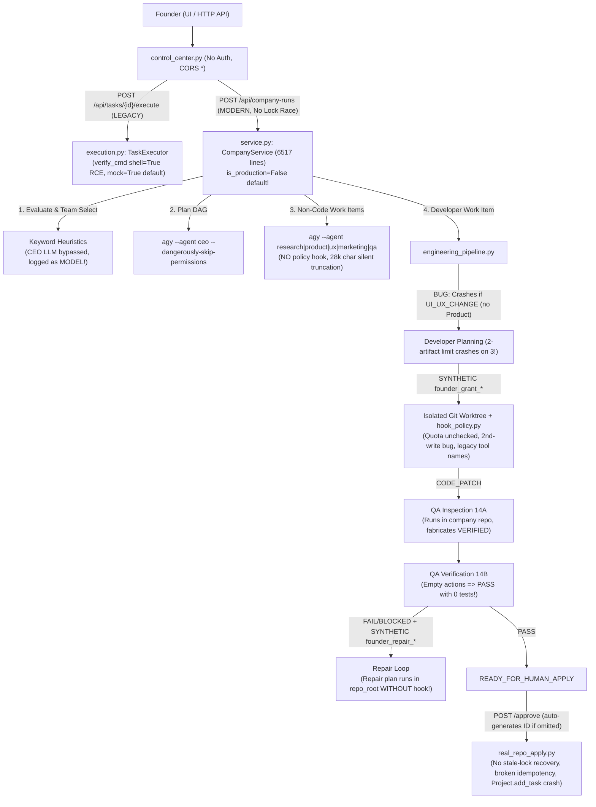

# სისტემის არქიტექტურის აუდიტი (SYSTEM ARCHITECTURE AUDIT)

**აუდიტის თარიღი:** 2026-11-23  
**აუდიტირებული კომიტი:** `b3b31b6` (`main`, სუფთა working tree, სინქრონიზებულია `origin/main`-თან)  
**აუდიტის ფაზები:** Phase A (სისტემის ინვენტარიზაცია) და Phase B (არქიტექტურული თანმიმდევრულობის აუდიტი)  
**სტატუსი:** დამოუკიდებელი, მტკიცებულებებზე დაფუძნებული აუდიტი (პროდაქშენ-კოდში ცვლილებების გარეშე)

---

## 1. Phase A — სისტემის სრული ინვენტარიზაცია (System Discovery)

### 1.1 მრავალ-რეპოზიტორიანი ეკოსისტემის რუკა

აუდიტის დროს შემოწმდა სამუშაო სივრცე და ყველა მომიჯნავე რეპოზიტორია (მხოლოდ წაკითხვის რეჟიმში):

| რეპოზიტორია / გზა | Git Remote | მიმდინარე ბრენჩი / კომიტი | რეალური სტატუსი | როლი შესრულების გზაში |
| :--- | :--- | :--- | :--- | :--- |
| `c:\Users\fiord\.gemini\antigravity-ide\scratch\JesterAICompany` | `https://github.com/farnai/JesterAICompany.git` | `main` @ `b3b31b6` (clean) | **ACTIVE (ავტორიტეტული ძრავა)** | 7-აგენტიანი კომპანიის ძრავა, Control Center, API, Frontend, ტესტები |
| `C:\Users\fiord\OneDrive\Desktop\Jester` | `git@github.com:farnai/Jester.git` | `codex/home-geometric-humanism` @ `e394ecc` (clean) | **ACTIVE (სამიზნე პროდუქტი)** | Jester-ის რეალური პროდუქტის კოდბაზა; Control Center-ის ნაგულისხმევი სამიზნე |
| `C:\Users\fiord\OneDrive\Desktop\JesterAICompany` | `git@github.com:farnai/JesterAICompany.git` | `main` @ `de4d755` | **STALE DUPLICATE** | 1 კომიტით ჩამორჩენილი დუბლიკატი Desktop-ზე; არ არის აქტიური შესრულების წყარო |
| `c:\Users\fiord\.gemini\antigravity-ide\scratch\jester` | `https://github.com/farnai/JesterAI.git` | `main` @ `700fa12` | **SHADOW / MISLEADING** | სახელწოდება `jester`, თუმცა რეალურად `JesterAI.git`-ზე მიუთითებს და არა `Jester.git`-ზე |
| `C:\Users\fiord\OneDrive\Desktop\JesterAI` | `git@github.com:farnai/JesterAI.git` | `feat/jst005-jst006-security-and-quotas` @ `203e898` | **SEPARATE / LEGACY-ADJACENT** | ცალკე რეპოზიტორია; `JesterAICompany`-ის აქტიურ კოდში არ გამოიძახება |
| `C:\Users\fiord\OneDrive\Desktop\JesterBridge` | `https://github.com/farnai/JesterBridge` | `main` @ `c360f89` | **OBSOLETE / ARCHIVED** | `BACKLOG.md:133-135`-ის მიხედვით არქივირებულია; კოდში ინტეგრაცია არ არსებობს |
| `C:\Users\fiord\OneDrive\Desktop\JesterControlCenter` | `git@github.com:farnai/JesterControlCenter.git` | `main` @ `40247f8` | **LEGACY / SUPERSEDED** | Control Center ფუნქციონალი ჩაშენებულია `JesterAICompany/jester_ai_company/control_center.py` + `frontend/`-ში |

> [!WARNING]
> **რეპოზიტორიის კონფიგურაციის კონფლიქტი (დადასტურებული):** `jester_ai_company/control_center.py:80-86` და რამდენიმე ტესტი (`tests/test_jester_live_run.py:88-91`, `tests/test_target_repository_guard.py`) მყარად (hardcoded) მოითხოვენ `C:\Users\fiord\OneDrive\Desktop\Jester`-ს ბრენჩით `main` და მოძველებული კომიტებით (`2173b2dd...` ან `cb7135ca...`), მაშინ როცა რეალური `Jester` რეპოზიტორია ამჟამად იმყოფება ბრენჩზე `codex/home-geometric-humanism` (`e394ecc`). შედეგად, target identity guard ავტომატურად ბლოკავს live გაშვებას `Jester`-ზე.

### 1.2 აქტიური, მემკვიდრეობითი (Legacy) და არასრული კომპონენტების ინვენტარი

#### ა) აქტიური ბირთვი (`jester_ai_company/`)
- **ორკესტრაცია და სერვისი:** `service.py` (6,517 ხაზი — მონოლითური "God-class" `CompanyService`), `orchestrator.py` (991 ხაზი), `dag.py` (373 ხაზი), `ceo_contract.py` (1,575 ხაზი), `engineering_pipeline.py` (1,236 ხაზი).
- **აგენტის კონტრაქტები და პარსერები:** `research_result.py`, `product_result.py`, `ux_result.py`, `marketing_result.py`, `developer_result.py`, `developer_mutation.py`, `qa_result.py`, `qa_execution.py`, `repair.py`.
- **უნიფიცირებული რანტაიმი და იზოლაცია:** `runtime.py` (`AntigravityRuntime` — იძახებს `agy.exe` v1.3.6-ს `subprocess.Popen`-ით), `worktree.py` (Git worktree მართვა), `policy_hook.py` (`.agents/hooks.json` + `hook_policy.py`), `execution_grant.py`, `verification.py`, `real_repo_apply.py`.
- **მონაცემთა მდგრადობა, კონტექსტი და ცოდნა:** `core.py`, `materializer.py`, `durable_storage.py`, `recovery.py`, `context.py`, `project.py`, `knowledge.py`, `telemetry.py`, `proposal.py`.
- **ვიზუალური პროტოტიპირება (STEP 24):** `design_concept.py`, `design_approval.py`, `design_recovery.py`, `prototype_renderer.py`.
- **Control Center და ინტერფეისი:** `control_center.py` (1,200 ხაზი — `ExclusiveThreadingHTTPServer`), `frontend/` (React + TypeScript + Vite + Vitest, 13 ტესტ-ფაილი / 74 ტესტი).
- **აგენტების დეფინიციები:** `.agents/agents/{ceo,product,research,ux,marketing,developer,qa}/agent.md`.

#### ბ) მემკვიდრეობითი (Legacy) კომპონენტები — ჯერ კიდევ აქტიურად მიბმული UI-სა და HTTP API-ზე!
- `jester_ai_company/execution.py` (`TaskExecutor`) — ძველი სინქრონული შესრულების ძრავა, სადაც CEO-ს პირდაპირ ეძლევა `invoke_subagent` და `verify_cmd` გაეშვება `shell=True`-ით.
- `control_center.py:729-795` (`/api/tasks/{id}/execute`, `/api/tasks/{id}/retry`) და `frontend/src/hooks/useCompanyState.ts:274` (`remediateTask` hardcoded `mock=true`-ით) კვლავ იყენებენ ამ Legacy ძრავას.
- `tools/verify_company.py` — ამოწმებს მხოლოდ 4 აგენტს (`ceo`, `product`, `developer`, `qa`) 7-ის ნაცვლად (`verify_company.py:19-24`)!
- `jester_ai_company/cli.py` და `status.py` — მხოლოდ read-only `status` ქვე-ბრძანება; `status.py:173` კითხულობს ძველ `.runs/run_*` დირექტორიებს და სრულად უგულებელყოფს თანამედროვე `.runs/company_runs/crun_*` გაშვებებს!

#### გ) არასრული ან ცარიელი იმპლემენტაციები
- `durable_storage.py:506-530` (`garbage_collect`) — ცარიელი stub (მხოლოდ `pass`/არაფერს შლის), შედეგად `.runs/` უკვე შეიცავს **1,979 ფაილს (10.53 MB)** და **349 `company_runs` ჩანაწერს**.
- `design_approval` HTTP ენდფოინთები `control_center.py`-ში და მეთოდები `frontend/src/api/client.ts`-ში — **სრულად არ არსებობს**, მიუხედავად იმისა, რომ `service.py:5772-5781` გადაჰყავს run `WAITING_FOR_HUMAN` მდგომარეობაში.
- გაუქმების (Cancellation) მექანიზმი — არ არსებობს `CANCELLED` სტატუსი (`orchestrator.py:118-136`) და არ არსებობს გაუქმების API.
- მოდელის კონფიგურაცია და fallback — `runtime.py` არ აკონტროლებს `--model`-ს, პროვაიდერის კვოტებს ან ფოლბექს; მთლიანად დამოკიდებულია ლოკალურ `agy.exe` ნაგულისხმევ პროფილზე (რომელიც ტესტების დროს იყენებდა Gemini 4 Neon-ს). არცერთი API გასაღები გარემოში (`JESTER|GEMINI|OPENAI|ANTHROPIC|CODEX`) არ არის დაყენებული; მხოლოდ `ANTIGRAVITY_AGENTAPI_EXE` არის აქტიური.

### 1.3 დაგეგმილი vs რეალურად იმპლემენტირებული არქიტექტურა

**დაგეგმილი (დოკუმენტაცია: `README.md`, `docs/ARCHITECTURE.md`, `BACKLOG.md`) vs რეალური იმპლემენტაცია:**

| პრინციპი | დოკუმენტირებული არქიტექტურა | რეალური იმპლემენტაცია (დადასტურებული კოდით) |
| :--- | :--- | :--- |
| **ერთიანი ორკესტრაცია** | აპლიკაციის მფლობელობაში არსებული DAG + სტრიქტული ფაზური კონტროლი | პარალელურად მუშაობს **ორი შეუთავსებელი ძრავა**: Legacy `TaskExecutor` და Modern `CompanyRun` |
| **ადამიანის თანხმობის კარიბჭეები** | "Zero synthetic/fabricated approvals" (`ARCHITECTURE.md:37,187`, `repair.py:18`) | `engineering_pipeline.py:591,870-873` **სინთეზურად აგენერირებს** `founder_grant_*` და `founder_repair_*`-ს; `control_center.py:916` ავტომატურად აგენერირებს `founder_ui_*`-ს |
| **CEO გადაწყვეტილებები** | CEO LLM აფასებს ამოცანას, არჩევს გუნდს და გეგმავს DAG-ს | Control Center (`is_production=False`) **საერთოდ არ იძახებს** CEO LLM-ს შეფასებისა და გუნდის შერჩევისთვის, თუმცა ტელემეტრიაში წერს `source="MODEL"` |
| **QA დამოუკიდებელი ვერიფიკაცია** | "missing/unexecutable tests forbid PASS" (`BACKLOG.md:41`) | თუ QA Inspection 14A დააბრუნებს `recommended_verification_actions: []`, 14B აბრუნებს **`PASS`-ს 0 გაშვებული ტესტით** |
| **უსაფრთხოება და იზოლაცია** | მკაცრი PreToolUse hook-ები, ნულოვანი shell წვდომა, დაცული კონტროლი | Control Center-ს აქვს **ავტორიზაციის გარეშე RCE** (`verify_cmd`), **Path Traversal** (`/assets/`, `/api/artifacts/content`), **Wildcard CORS (`*`)**, ხოლო Repair Planning ეშვება `self.repo_root`-ში hook-ის გარეშე |
| **პროექტ-აგნოსტიკურობა** | ზოგადი, ნებისმიერ პროექტზე მორგებადი კომპანიის ძრავა | Jester-ის, ქართული `/auth/register`-ის, `#FF7A2F`-ის, `crun_29fcdd4a`-ისა და Desktop გზების მყარი ჩაშენება ბირთვის მოდულებში |

---

## 2. Phase B — არქიტექტურული თანმიმდევრულობის აუდიტი

### 2.1 პასუხისმგებლობის საზღვრები (Responsibility Boundaries)

შემოწმდა 7-ვე აგენტის `.agents/agents/*/agent.md` ინსტრუქცია და მათი შესაბამისი Python ორკესტრაციის ლოგიკა:

1. **პასუხისმგებლობების გადაფარვა და კონფლიქტები:**
   - **CEO vs Python ორკესტრატორი (`service.py` / `ceo_contract.py`):** CEO-ს ინსტრუქცია (`ceo/agent.md`) აცხადებს, რომ CEO აფასებს მოთხოვნებს, არჩევს სპეციალისტებს და აგეგმარებს DAG-ს. რეალურად `service.py:4714-4815`-ში (`is_production=False`) კომპანიის მთავარი გადაწყვეტილებები (`EXECUTE`/`ASK_FOUNDER`/`INVESTIGATE` და გუნდის შერჩევა) წყდება keyword-ჰევრისტიკებით.
   - **Product vs Developer მოთხოვნების ცვლილებაზე:** `developer/agent.md` კრძალავს Product მოთხოვნების თვითნებურ შეცვლას და ავალდებულებს `requirement_conflict_detected` ფლაგის აწევას (`repair.py`), რაც სწორია არქიტექტურულად; თუმცა **Developer-ის `agent.md` საერთოდ არ ახსენებს Mode C-ს (Repair Planning)** და `requirement_conflict_detected` კონტრაქტს.
   - **UX vs Product (`UI_UX_CHANGE` საკუთრების ხვრელი):** `ceo_contract.py:1414` თვლის, რომ `UI_UX_CHANGE` ამოცანაზე Product აგენტი არ არის საჭირო და არჩევს `["ux", "developer"]`-ს. `dag.py:199-210` ამ გეგმას ადასტურებს. მაგრამ `engineering_pipeline.py:187-207` ითხოვს **ორივე** Product და UX ელემენტს, რაც იწვევს დეტერმინისტულ ავარიას (`EngineeringPreconditionError`).
   - **QA Inspection (14A) vs QA Verification (14B) vs QA Planning:** `qa/agent.md:47` იყენებს capability-ს `"audit"`, მაშინ როცა `orchestrator.py:340` ითხოვს `"read_only_audit"`. ამასთან, `qa_result.py:497-533` წინასწარ (14A სტატიკური ინსპექციის ეტაპზე, ტესტების გაშვებამდე!) აყალბებს `FUNCTIONAL_CORRECTNESS = VERIFIED` სტატუსს.
   - **უპატრონო პასუხისმგებლობები (Missing Ownership):** არცერთ კომპონენტს არ ეკუთვნის რეალური რანტაიმის პროცესების გაუქმება (cancellation), სტანდარტული `.runs/` დასუფთავება (GC), stale lock-ების აღდგენა და Control Center-ის ავთენტიფიკაცია.

### 2.2 CEO ორკესტრაციის რეალობის შემოწმება

კითხვა: **რეალურად უწევს თუ არა CEO აგენტი კოორდინაციას შესრულებას, თუ მხოლოდ გეგმას აგენერირებს?**

დადასტურებული პასუხი: **CEO აგენტი რეალურად არის მხოლოდ ერთჯერადი JSON-DAG გენერატორი (და არა აქტიური კოორდინატორი).**

| CEO ფუნქცია | რეალური მდგომარეობა კოდში | მტკიცებულება |
| :--- | :--- | :--- |
| ამოცანის ინტერპრეტაცია | ნაგულისხმევ რეჟიმში (`is_production=False`) სრულდება keyword-ჰევრისტიკით; `is_production=True`-შიც LLM იძახება მხოლოდ მაშინ, თუ ჰევრისტიკამ `INVESTIGATE` დააბრუნა | `service.py:4714-4815`, `control_center.py:1149`, ტესტი `AUDIT-BUG-12` |
| წინასწარი კვლევა (`INVESTIGATE`) | **იმიტირებულია:** `investigate_objective` არ კითხულობს არცერთი ფაილის შიგთავსს და არ იძახებს აგენტს — ამოწმებს მხოლოდ `Path.is_file()` / `is_dir()` | `service.py:4816-4889` |
| სპეციალისტების შერჩევა | `is_production=False`-ში 100% keyword-ჰევრისტიკა; თუ `enforce_strict_roles=False` (ნაგულისხმევი), `ceo_contract.py:425-426` ადგილზევე ცვლის `selected_roles`-ს | `service.py:4970-5005`, `ceo_contract.py:425-426` |
| დელეგირება და DAG შესრულება | მთლიანად აპლიკაციის (`CompanyService.execute_next_company_work`) მფლობელობაშია — **სექვენციური** (ერთ ჯერზე მხოლოდ 1 ready item სრულდება, მიუხედავად იმისა, რომ DAG ფან-აუთს იძლევა) | `service.py:5330-5460` |
| პასუხების შეგროვება და კონფლიქტების გადაჭრა | აპლიკაცია აგროვებს `EmployeeResultSummary`-ს; **კონფლიქტის გადაჭრის ან replan-ის მექანიზმი სპეციალისტებს შორის კოდში არ მუშაობს** (replan ხდება მხოლოდ დამფუძნებლის clarification-ის შემდეგ) | `service.py:5718-5727`, `recovery.py` |
| შეცდომის აღდგენა და გადამისამართება | მართავს `recovery.py` + `service.py:_handle_work_item_failure`; CEO არ იძახება შეცდომის გასაანალიზებლად ან სპეციალისტის შესაცვლელად | `recovery.py:250-350`, `service.py:5820+` |
| დასრულების ვერიფიკაცია | არაკოდურ DAG-ში run სრულდება `COMPLETED`-ით, როგორც კი ყველა work item-ის JSON პარსირება წარმატებით დასრულდება; კოდურ პაიპლაინში კი `QA PASS` შეიძლება დაბრუნდეს 0 ტესტით (`AUDIT-BUG-03`) | `qa_execution.py:550`, `service.py:5785-5800` |
| დამფუძნებელთან ესკალაცია | Clarification pause მუშაობს, მაგრამ Control Center-ში შუა-შესრულების clarification resume გაფუჭებულია (`control_center.py:1072`), ხოლო დიზაინის approval endpoint საერთოდ არ არსებობს | `control_center.py:1072`, `service.py:5772-5781` |

### 2.3 არქიტექტურული წინააღმდეგობების რეესტრი (Architecture Contradictions)

ქვემოთ მოყვანილია დადასტურებული წინააღმდეგობები სისტემის სხვადასხვა ფენას შორის, ავტორიტეტული წყაროს მითითებით და შერიგების რეკომენდაციით:

| # | წინააღმდეგობა | მხარე A | მხარე B | ავტორიტეტული წყარო | რეკომენდებული შერიგება |
| :-: | :--- | :--- | :--- | :--- | :--- |
| **C1** | **სინთეზური თანხმობები** | `ARCHITECTURE.md:37,187` & `repair.py:18`: „Approvals are never fabricated“ | `engineering_pipeline.py:591,870-873` აგენერირებს `founder_grant_*` და `founder_repair_*`-ს | **უსაფრთხოების პოლიტიკა (`ARCHITECTURE.md` / `repair.py`)** | ამოიღეთ ყველა სინთეზური approval ID; საჭიროების შემთხვევაში გააჩერეთ run `WAITING_FOR_HUMAN` მდგომარეობაში ან ცალსახად გამოყავით sandboxed worktree-ის ნებართვა Founder Apply-ისგან |
| **C2** | **`UI_UX_CHANGE` გუნდი vs Fan-In** | `ceo_contract.py:1414` & `dag.py:199-210`: უშვებს `["ux", "developer"]`-ს | `engineering_pipeline.py:187-207`: აგდებს `EngineeringPreconditionError`-ს, თუ Product არ არის | **Adaptive Team Selection (`ceo_contract.py` + `dag.py`)** | განაახლეთ `engineering_pipeline.py` და `execute_developer_planning_task`, რათა `UI_UX_CHANGE`-ზე მხოლოდ UX არტეფაქტი საკმარისი იყოს |
| **C3** | **3 არტეფაქტი Developer Planning-ში** | `engineering_pipeline.py:445-450`: ამატებს 3 არტეფაქტს (`PRD`, `UX_SPEC`, `UX_PROTOTYPE`) | `service.py:1983`: მკაცრად მოითხოვს `len(input_artifacts) == 2` | **STEP 24 ვიზუალური პროტოტიპირება (`engineering_pipeline.py`)** | გააფართოვეთ `execute_developer_planning_task` არასავალდებულო `UX_PROTOTYPE` / `DESIGN_CONCEPT` არტეფაქტების მხარდასაჭერად |
| **C4** | **CEO Prompt vs Parser Enums** | `ceo/agent.md:76,137`: `"audit"`, `"FEATURE"`, `"GENERAL"` | `orchestrator.py:340`: `"read_only_audit"`; `ceo_contract.py:890`: `LARGE_FEATURE`, `PRODUCT_SPECIFICATION`, `MIXED_UNKNOWN` | **Python ვალიდატორები (`orchestrator.py`, `ceo_contract.py`)** | გაასწორეთ `ceo/agent.md` და `qa/agent.md` ზუსტი enum-ებით და დაამატეთ ავტომატური კონტრაქტ-ტესტი prompt ↔ enum შესაბამისობაზე |
| **C5** | **QA `PASS` 0 გაშვებული ტესტით** | `BACKLOG.md:41` & `qa_execution.py`: "missing/unexecutable tests forbid PASS" | `qa_execution.py:540,550`: თუ `action_audits == []`, ნებას რთავს `PASS`-ს | **QA ინვარიანტი (უსაფრთხოების მოთხოვნა)** | ნებისმიერ `CODE_PATCH`-ზე 0 გაშვებული ტესტი ავტომატურად უნდა გადავიდეს `BLOCKED`-ში |
| **C6** | **სპეციალისტების Prompt vs JSON სქემები** | `product/ux/research/marketing/agent.md`: Markdown სექციები და „no extra fields“ | `*_result.py`: მკაცრი JSON სქემები (`schema_version`, `concepts`, `deliverables`, `findings.claim`) | **Python სქემის პარსერები (`*_result.py`)** | სინქრონიზაცია გაუკეთეთ ყველა `agent.md`-ს რეალურ JSON კონტრაქტებთან და მოაშორეთ ურთიერთგამომრიცხავი წესები |
| **C7** | **`EXACT_APPROVED_PATCH_PRESENT` იდემპოტენტობა** | `README.md:223` & `ARCHITECTURE.md:203`: იდემპოტენტური აღდგენა crash-ის შემდეგ | `service.py:4469-4477`: უპირობოდ აგდებს `TargetRepositoryDirtyError`-ს | **ტრანზაქციული აღდგენის სპეციფიკაცია (`real_repo_apply.py:1057`)** | დაამატეთ `EXACT_APPROVED_PATCH_PRESENT`-ის იდემპოტენტური დამუშავება `execute_real_repo_apply`-ში |
| **C8** | **დოკუმენტაცია vs რეალობა** | `README.md` / `ARCHITECTURE.md` / `BACKLOG.md`: „Control Center is DEFERRED“, „no integration with Jester yet“, „144/495 tests passing“ | Control Center + React UI სრულად აგებულია; `control_center.py:80` პირდაპირ `Desktop/Jester`-ზეა მიბმული; რეალური ტესტ-სუიტი **929 ტესტია (16 FAILED, 10 ERRORS)** | **რეალური კოდბაზა** | გადაწერეთ დოკუმენტაცია რეალური მდგომარეობის შესაბამისად, მას შემდეგ რაც P0/P1 დეფექტები გასწორდება |
| **C9** | **`policy_hook.py` in-memory vs გენერირებული სკრიპტი** | `authorize_tool_mutation` (`policy_hook.py:164`) უშვებს ახლად შექმნილი ფაილის მეორეჯერ რედაქტირებას | გენერირებული `hook_policy.py` (`policy_hook.py:333,383`) ბლოკავს მას, არ ამოწმებს byte/file კვოტას და არ ცნობს `read_file`/`write_file`/`edit_file`-ს | **ერთიანი პოლიტიკის ლოგიკა** | გააერთიანეთ ლოგიკა ერთი საერთო მოდულის გამოძახებით და განაახლეთ `agy` 1.3.6-ის რეალური tool-ების სახელები |
| **C10** | **დუალიზმი: Legacy `TaskExecutor` vs `CompanyRun`** | Control Center UI-ში Task execution / Remediate (`mock=True`) იყენებს `execution.py`-ს | მთავარი კომპანიის არქიტექტურა არის `CompanyRun` + `EngineeringPipelineAdapter` | **Modern `CompanyRun` ძრავა** | გამორთეთ ან მკაცრად იზოლირეთ Legacy `TaskExecutor` (განსაკუთრებით `verify_cmd` RCE) და გააერთიანეთ UI-ს სამუშაო ნაკადი `CompanyRun`-ზე |
